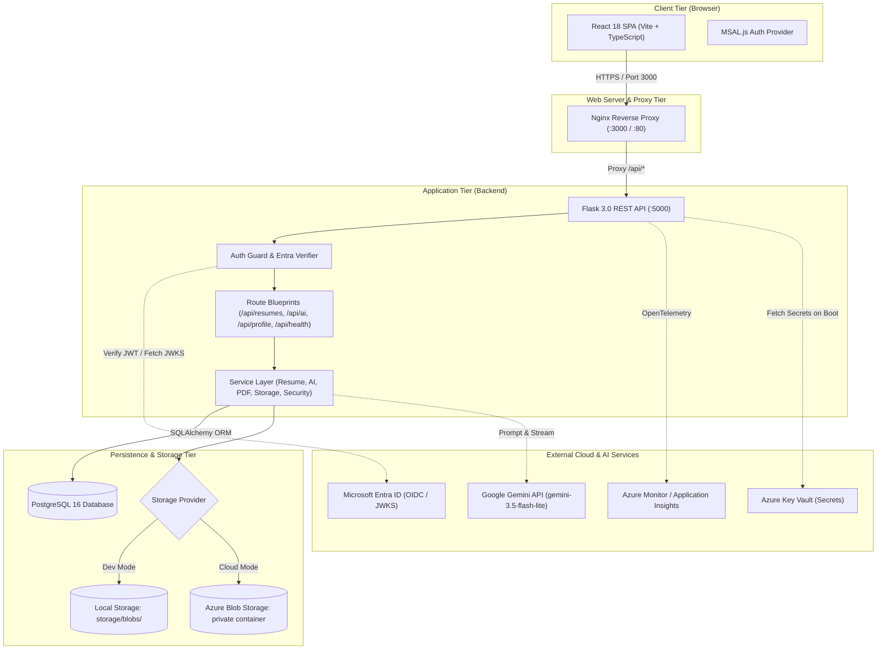

# CloudResumeAI: AI-Powered Cloud Resume Platform

An enterprise-ready, AI-orchestrated cloud resume engineering platform designed for intelligent resume customization, ATS score optimization, server-side vector PDF generation, and automated cloud deployment.

> **Academic Context**: Developed as a comprehensive Second-Year Information Technology / Computer Engineering project demonstrating core **Cloud Computing** principles: Containerization, Platform as a Service (PaaS), OAuth 2.0 / OpenID Connect, Object Storage, Infrastructure as Code (Bicep), CI/CD automation, and Cost Optimization.

---

## Table of Contents
1. [Project Overview](#project-overview)
2. [Problem Statement & Objectives](#problem-statement--objectives)
3. [Key Features](#key-features)
4. [Technology Stack](#technology-stack)
5. [System Architecture](#system-architecture)
6. [Subsystems Deep Dive](#subsystems-deep-dive)
   - [Frontend Architecture](#frontend-architecture)
   - [Backend REST API](#backend-rest-api)
   - [Database & Data Isolation](#database--data-isolation)
   - [Google Gemini AI Integration](#google-gemini-ai-integration)
   - [ReportLab PDF Generation](#reportlab-pdf-generation)
   - [Microsoft Entra ID Authentication](#microsoft-entra-id-authentication)
   - [Azure Cloud Infrastructure](#azure-cloud-infrastructure)
   - [Monitoring & Security Auditing](#monitoring--security-auditing)
   - [CI/CD & Infrastructure as Code](#cicd--infrastructure-as-code)
7. [API Endpoint Summary](#api-endpoint-summary)
8. [Local Installation & Setup](#local-installation--setup)
9. [Docker Setup](#docker-setup)
10. [Testing & Verification](#testing--verification)
11. [User Interface Screenshots](#user-interface-screenshots)
12. [Project Limitations & Future Scope](#project-limitations--future-scope)
13. [Documentation Index](#documentation-index)
14. [Contributors & License](#contributors--license)

---

## Project Overview

**CloudResumeAI** bridges the gap between modern cloud-native engineering and real-world job application workflows. Job seekers can draft, customize, and maintain multiple resumes, evaluate their resumes against target job descriptions using **Google Gemini AI**, and download pixel-perfect, ATS-friendly vector PDFs.

The entire project is built following strict cloud-native architectural patterns:
- **Zero Secrets in Code**: All sensitive credentials are strictly managed through environment variables and Azure Key Vault.
- **Least-Privilege Security**: Managed identities and role-based access control (RBAC) govern cloud access.
- **Cost-Optimized Cloud Footprint**: Built to run on Azure serverless tiers with scale-to-zero in development environments.

---

## Problem Statement & Objectives

### Problem Statement
1. **Applicant Tracking System (ATS) Barriers**: Up to 75% of qualified resumes are eliminated by automated scanning systems due to poor formatting or missing role-specific keywords.
2. **Cloud Architecture Educational Gap**: Traditional student projects often rely on unscalable monoliths with hardcoded credentials and manual deployments, failing to reflect modern cloud-native industry standards.

### Project Objectives
- Engineer a high-performance **React 18** Single Page Application with dynamic resume previewing and ATS scoring.
- Implement a robust **Python 3.12 Flask REST API** backed by an ACID-compliant **PostgreSQL 16** database.
- Integrate Google Gemini (`gemini-3.5-flash-lite`) with sub-second response times, exponential retry backoff, and gateway timeout protection.
- Generate high-fidelity vector PDFs server-side using **ReportLab** without the overhead of headless browsers.
- Implement enterprise authentication via **Microsoft Entra ID (Azure AD)** and OAuth 2.0 / OpenID Connect.
- Provide dual-mode private object storage (local filesystem fallback and **Azure Blob Storage**).
- Automate testing, linting, Docker builds, and cloud provisioning using **GitHub Actions** and **Azure Bicep**.

---

## Key Features

- **Multi-Template Resume Builder**: Toggle between *Modern*, *Executive*, and *Minimal* layouts with live real-time preview.
- **Google Gemini Career Assistant**:
  - *Summary Improver*: Generates punchy, executive-level summaries based on candidate experience.
  - *Experience Enhancer*: Rephrases bullet points into action-driven statements using Google's XYZ formula (*Accomplished [X], measured by [Y], by doing [Z]*).
  - *Job Description Matcher*: Calculates ATS match score (0-100%), reveals keyword gaps, and suggests tailoring tips.
  - *Interactive AI Career Coach*: Conversational assistant offering customized interview and resume advice.
- **Server-Side PDF Export**: Generates vector-quality, ATS-readable PDFs in milliseconds.
- **Enterprise IAM**: Microsoft Entra ID authentication with JWT verification against Microsoft's public JWKS endpoints.
- **Cloud Observability**: Structured JSON logging, `X-Request-ID` correlation, `Server-Timing` latency metrics, and health probes (`/api/health`, `/api/health/live`, `/api/health/ready`).
- **Cost Protection**: Azure Bicep templates include consumption budget alert rules and scale-to-zero for non-production environments.

---

## Technology Stack

| Layer | Technology | Details |
| :--- | :--- | :--- |
| **Frontend SPA** | React 18, TypeScript, Vite 5 | Tailwind CSS, Lucide Icons, Dev Auth & Google / OIDC |
| **Backend REST API** | Python 3.12, Flask 3.0, Gunicorn | Application Factory, SQLAlchemy ORM, Pydantic v2 |
| **Database** | PostgreSQL 16 | Google Cloud SQL / Azure Database / Local PostgreSQL |
| **AI Model** | Google Gemini (`gemini-3.5-flash-lite`)| Official Google GenAI SDK, 20s timeout, exponential backoff |
| **PDF Engine** | Python ReportLab 4.x | In-memory canvas rendering, vector typography |
| **Storage** | Google Cloud Storage (GCS), Azure Blob & Local | Private buckets/containers, user partition isolation |
| **Identity (IAM)** | Google Identity / Entra ID / Dev Auth | OAuth 2.0 / OIDC, JWKS caching, dev auth fallback |
| **IaC & Cloud** | Google Cloud Platform (GCP) & Azure | **Terraform** (`infra/terraform`), **Google Cloud Run**, Secret Manager |
| **CI / CD** | GitHub Actions | Flake8, Pytest, Vitest, Docker build, Cloud Run deploy |
| **Monitoring** | Cloud Logging & OpenTelemetry | `X-Request-ID` tracing, `Server-Timing`, Log Analytics |

---

## System Architecture



---

## Subsystems Deep Dive

### Frontend Architecture
- Built with **React 18** and **TypeScript** using **Vite**.
- Uses an authentication context wrapping `@azure/msal-react` for Microsoft Entra ID login.
- Features modular component architecture: resume sections (Experiences, Education, Projects, Skills), ATS match indicator, template switchers, and AI coach side-panel.

### Backend REST API
- Organized via Flask **Application Factory** pattern (`app/__init__.py`).
- Clear separation into **Routes** (HTTP handling), **Schemas** (Pydantic validation), **Services** (business logic), and **Repositories** (database operations).
- Emits structured error envelopes with HTTP status codes and `X-Request-ID` trace headers.

### Database & Data Isolation
- Relational schema in PostgreSQL 16 with UUID primary keys and cascading deletions.
- Data tenancy is enforced on every query (`WHERE user_id = :current_user_id`).
- Unauthorized cross-user access attempts return HTTP 404 (preventing ID enumeration) and trigger security audit events.
- See [`docs/database.md`](file:///C:/Users/hp/.gemini/antigravity/scratch/CloudResumeAI/docs/database.md) for full ER diagrams.

### Google Gemini AI Integration
- Powered by `gemini-3.5-flash-lite` for optimal response latency (typically 800ms - 1.4s).
- SDK timeout configured via `types.HttpOptions(timeout=20000)`.
- Handles rate-limiting (HTTP 429) via exponential backoff; maps server timeouts to `504 Gateway Timeout`.
- Emits performance metrics via `Server-Timing: gemini;dur=<ms>`.

### ReportLab PDF Generation
- Compiles resume data into high-resolution vector PDF streams directly in memory.
- Renders multiple template styles with precise typography, custom margins, and bullet formatting.
- Caches PDFs in object storage using partition naming: `users/{user_id}/resumes/{resume_id}.pdf`.

### Microsoft Entra ID Authentication
- Dual-mode authentication:
  - **Production**: Validates JWT Bearer tokens against Microsoft's public JWKS endpoints with in-memory RSA key caching.
  - **Development**: Controlled `X-Dev-User-Email` header, strictly blocked in production environments (`FLASK_ENV=production`).
- Implements Just-in-Time (JIT) provisioning for new users on initial login.

### Azure Cloud Infrastructure
- Declarative **Azure Bicep** templates provision all cloud resources.
- Configured with a **User-Assigned Managed Identity** adhering to least-privilege RBAC:
  - `Storage Blob Data Contributor` (scoped only to the resume blob storage account).
  - `Key Vault Secrets User` (scoped only to application secrets).
  - `AcrPull` (scoped only to Azure Container Registry).
- Detailed cloud architecture guide in [`infra/README.md`](file:///C:/Users/hp/.gemini/antigravity/scratch/CloudResumeAI/infra/README.md).

### Monitoring & Security Auditing
- **Structured Logging**: Timestamps formatted in ISO UTC, request IDs, and module names.
- **SensitiveDataFilter**: Scrubs Bearer tokens, Gemini keys, and passwords before logging.
- **Security Monitor**: Tracks failed authentication attempts; raises alerts when >= 5 failures occur in 5 minutes.
- **Probes**: `/api/health` (comprehensive), `/api/health/live` (liveness), and `/api/health/ready` (readiness).

### CI/CD & Infrastructure as Code
- **CI Workflow (`ci.yml`)**: Triggered on push and pull requests; executes Flake8, Pytest (109 tests), Vitest (52 tests), TypeScript typechecking, and Docker builds.
- **Deploy Workflow (`deploy.yml`)**: Manual deployment using OIDC federated credentials, deploying Bicep templates and updating Container Apps revisions.

---

## API Endpoint Summary

| Method | Endpoint | Auth | Purpose |
| :--- | :--- | :--- | :--- |
| `GET` | `/api/health` | Public | Comprehensive health check (DB + Storage) |
| `GET` | `/api/health/live` | Public | Fast container liveness probe |
| `GET` | `/api/health/ready` | Public | Container readiness probe (returns 503 if DB disconnected) |
| `GET` | `/api/resumes` | Required | List all resumes belonging to authenticated user |
| `POST`| `/api/resumes` | Required | Create a new resume with nested sections |
| `GET` | `/api/resumes/<id>` | Required | Retrieve full resume details |
| `PUT` | `/api/resumes/<id>` | Required | Update resume details and sections |
| `DELETE`| `/api/resumes/<id>`| Required | Delete resume and associated cached PDF |
| `POST`| `/api/resumes/<id>/export-pdf`| Required | Generate and download ReportLab PDF |
| `GET` | `/api/resumes/<id>/export-pdf`| Required | Download cached PDF |
| `GET` | `/api/profile` | Required | Retrieve current user profile settings |
| `PUT` | `/api/profile` | Required | Update user profile information |
| `GET` | `/api/ai/status` | Public | Check if Gemini API is ready & verify model |
| `POST`| `/api/ai/improve-summary` | Required | AI career summary enhancement |
| `POST`| `/api/ai/improve-experience`| Required | AI experience bullet point optimizer (XYZ formula)|
| `POST`| `/api/ai/match-job` | Required | Calculate ATS match score & keyword gaps |
| `POST`| `/api/ai/chat` | Required | Conversational AI resume coaching |

For detailed payloads and response schemas, see [`docs/api.md`](file:///C:/Users/hp/.gemini/antigravity/scratch/CloudResumeAI/docs/api.md).

---

## Local Installation & Setup

### GitHub Repository
- **Repository Name**: `CLOUDRESUME_CC`
- **Clone Command**:
  ```bash
  git clone https://github.com/<your-username>/CLOUDRESUME_CC.git
  cd CLOUDRESUME_CC
  ```

### Prerequisites
- Node.js `v20+` and npm
- Python `3.12`
- Docker & Docker Compose
- Git

### Dual-Terminal Setup

#### Terminal 1: Database & Backend
```bash
# 1. Start local PostgreSQL container
docker run -d --name cloudresumeai-postgres \
  -e POSTGRES_USER=cloudresume_user \
  -e POSTGRES_PASSWORD=cloudresume_password_placeholder \
  -e POSTGRES_DB=cloudresumeai_dev \
  -p 5432:5432 postgres:16-alpine

# 2. Setup Python environment
cd backend
python -m venv .venv
# Activate virtual environment (Windows: .venv\Scripts\Activate.ps1 | Linux/Mac: source .venv/bin/activate)
pip install -r requirements.txt -r requirements-dev.txt

# 3. Configure environment
cp .env.example .env

# 4. Run migrations & start server
flask db upgrade
python wsgi.py
```

#### Terminal 2: Frontend
```bash
cd frontend
npm install
cp .env.example .env
npm run dev
```
Open `http://localhost:5173` in your browser.

---

## Docker Setup

To run the complete containerized application in a single command:

```bash
docker-compose up --build
```
- Frontend: `http://localhost:3000`
- Backend API: `http://localhost:5000`
- Health Check: `http://localhost:3000/api/health`

---

## Testing & Verification

All test suites have been verified with a **100% pass rate**:

```bash
# 1. Backend Linting (Flake8) - 0 errors
backend/.venv/Scripts/flake8 backend/app backend/tests

# 2. Backend Automated Tests (Pytest) - 109 Passed
backend/.venv/Scripts/pytest backend/tests -v

# 3. Frontend Tests (Vitest) - 52 Passed across 7 files
npm --prefix frontend test -- --run

# 4. Frontend Typecheck & Build - 0 errors
npm --prefix frontend run build

# 5. Docker Compose Config Validation - Valid
docker-compose config
```

Full testing documentation available in [`docs/testing.md`](file:///C:/Users/hp/.gemini/antigravity/scratch/CloudResumeAI/docs/testing.md).

---

## User Interface Screenshots

*Below are UI reference placeholders representing the production interfaces:*

```text
+----------------------------------------------------------------------------------------+
|  CloudResumeAI                [Resumes]  [Templates]  [AI Coach]   (Jane Doe - Profile) |
+----------------------------------------------------------------------------------------+
|                                                                                        |
|  +-- RESUME EDITOR -------------------------+  +-- LIVE PREVIEW & ATS SCORE --------+  |
|  | Title: Cloud DevOps Engineer              |  | ATS Compatibility Score: 88%       |  |
|  | Template: [ Executive v ]                |  | [||||||||||||||||||||||||..]       |  |
|  |                                          |  |                                    |  |
|  | Target Role: Senior Cloud Engineer       |  | Jane Doe                           |  |
|  | Target Company: Microsoft                |  | jane.doe@example.com | Seattle, WA |  |
|  |                                          |  |                                    |  |
|  | [Summary Section]                        |  | Professional Summary:              |  |
|  | Results-driven Cloud Engineer with 3+... |  | Results-driven Cloud Engineer...   |  |
|  | [ AI Improve Summary ]                    |  |                                    |  |
|  |                                          |  | Experience:                        |  |
|  | [Experience: Cloud DevOps Intern]        |  | • Architected Azure Bicep IaC...   |  |
|  | • Built Bicep templates for deployment   |  | • Optimized container build time   |  |
|  | [ AI Bullet Optimizer ]                   |  |                                    |  |
|  |                                          |  | [ Download Professional PDF ]       |  |
|  +------------------------------------------+  +------------------------------------+  |
+----------------------------------------------------------------------------------------+
```

---

## Project Limitations & Future Scope

### Honest Project Limitations
1. **Live Azure Deployment Status**: The infrastructure templates (Bicep) and GitHub Actions deploy workflows are fully implemented and verified via automated tests, but live deployment to Azure was not executed to avoid incurring student cloud billing.
2. **Microsoft Entra ID Tenant Verification**: Live corporate tenant login requires active tenant admin consent; in local development, an authenticated test identity is simulated via controlled development headers.
3. **Application Insights Live Ingestion**: OpenTelemetry is configured with zero-crash fallback and remains dormant locally until an active connection string is supplied.

### Realistic Future Enhancements
- Asynchronous task worker for bulk resume exports.
- Resume parsing via OCR or document intelligence to import existing PDF resumes.
- Multi-lingual resume generation and international date/format localization.

---

## Documentation Index

Comprehensive engineering guides are available in the [`docs/`](file:///C:/Users/hp/.gemini/antigravity/scratch/CloudResumeAI/docs/) directory:
- [Google Cloud Platform (GCP) Architecture & Migration Guide](file:///C:/Users/hp/.gemini/antigravity/scratch/CloudResumeAI/docs/GCP_MIGRATION_AND_ARCHITECTURE.md)
- [System Architecture & Design Diagrams](file:///C:/Users/hp/.gemini/antigravity/scratch/CloudResumeAI/docs/architecture.md)
- [Database Schema & ER Documentation](file:///C:/Users/hp/.gemini/antigravity/scratch/CloudResumeAI/docs/database.md)
- [REST API Endpoint Specification](file:///C:/Users/hp/.gemini/antigravity/scratch/CloudResumeAI/docs/api.md)
- [Cloud Computing Concept Mapping](file:///C:/Users/hp/.gemini/antigravity/scratch/CloudResumeAI/docs/cloud-computing-concepts.md)
- [Setup & Deployment Manual](file:///C:/Users/hp/.gemini/antigravity/scratch/CloudResumeAI/docs/setup-and-deployment.md)
- [Testing & Quality Assurance Report](file:///C:/Users/hp/.gemini/antigravity/scratch/CloudResumeAI/docs/testing.md)
- [Student Viva & Oral Exam Guide](file:///C:/Users/hp/.gemini/antigravity/scratch/CloudResumeAI/docs/viva-questions.md)
- [Project Presentation Guide](file:///C:/Users/hp/.gemini/antigravity/scratch/CloudResumeAI/docs/project-presentation.md)
- [Azure Target Architecture Guide](file:///C:/Users/hp/.gemini/antigravity/scratch/CloudResumeAI/infra/README.md)

---

## Contributors & License

- **Engineering Candidate / Student**: Information Technology & Cloud Computing Project
- **Course**: Second-Year Cloud Computing Lab & Project
- **License**: MIT Open Source License
