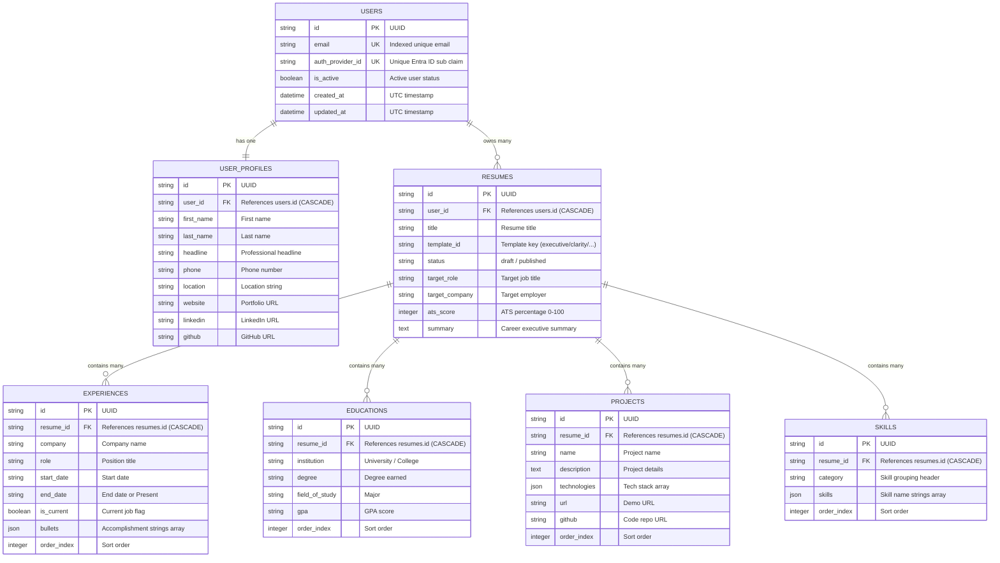
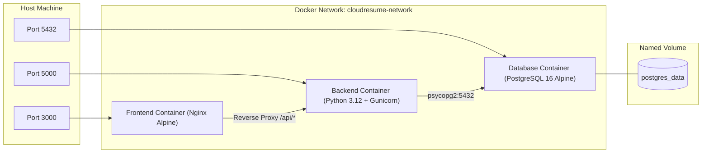
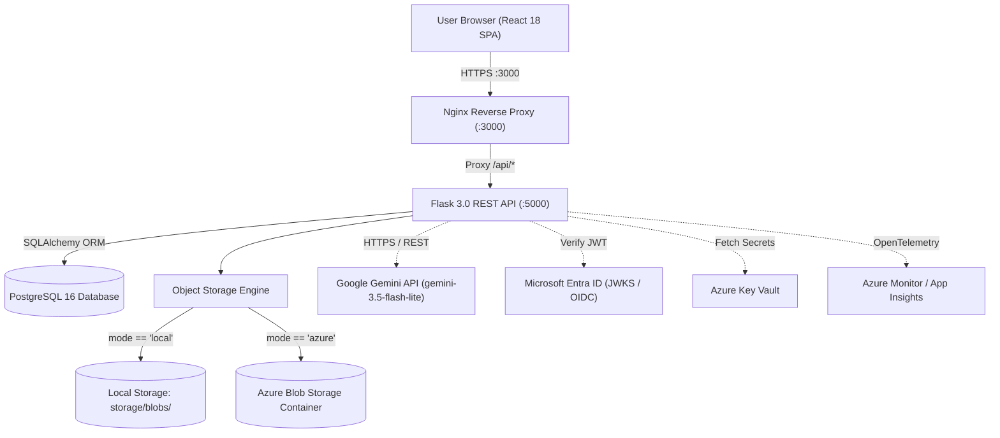
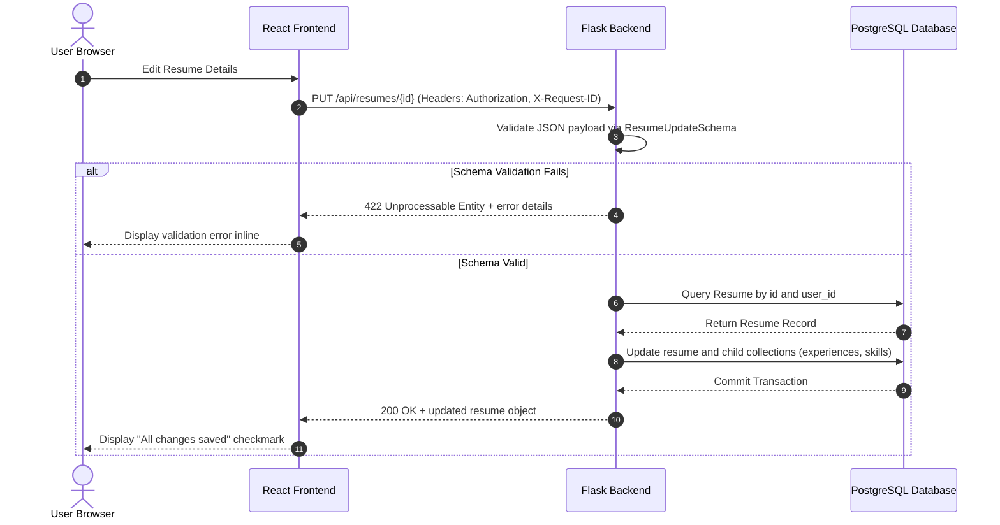
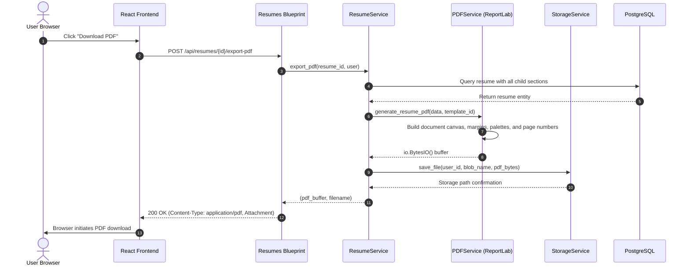
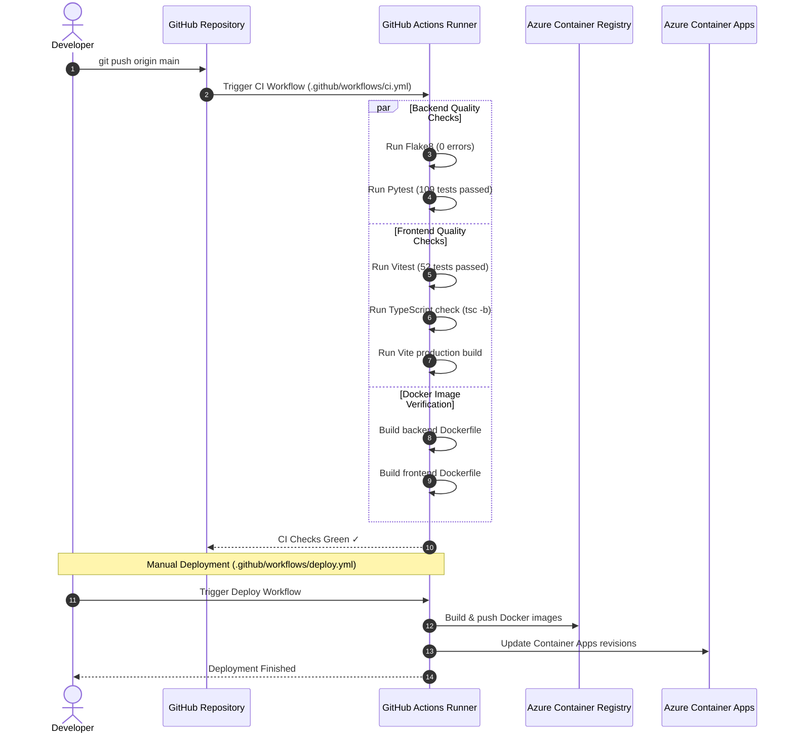

# CloudResumeAI — Complete Technical Breakdown & Cloud Computing Concept Analysis

> **Course**: Cloud Computing & Distributed Systems Lab  
> **Project Title**: CloudResumeAI — AI-Powered Cloud Resume Platform  
> **GitHub Repository**: [https://github.com/dhanashri58/CloudResume_CC](https://github.com/dhanashri58/CloudResume_CC)  
> **Local Workspace**: `C:\Users\hp\.gemini\antigravity\scratch\CloudResumeAI`  
> **Status**: Development completed across Stages 1–10; clean local testing; cloud deployment-ready via Azure Bicep & GitHub Actions.

---

## Document Navigation
- [Part 1 — Project Introduction & Pitch](#part-1--project-introduction--pitch)
- [Part 2 — Complete Technology Stack & Evidence Matrix](#part-2--complete-technology-stack--evidence-matrix)
- [Part 3 — Frontend Architecture & UI Breakdown](#part-3--frontend-architecture--ui-breakdown)
- [Part 4 — Backend Architecture & Service Layer](#part-4--backend-architecture--service-layer)
- [Part 5 — Database Schema, ORM & Data Isolation](#part-5--database-schema-orm--data-isolation)
- [Part 6 — Authentication & Cloud Security Architecture](#part-6--authentication--cloud-security-architecture)
- [Part 7 — Google Gemini AI Integration & Optimization](#part-7--google-gemini-ai-integration--optimization)
- [Part 8 — Server-Side PDF Generation & Cloud Storage](#part-8--server-side-pdf-generation--cloud-storage)
- [Part 9 — Docker Containerization & Microservice Topology](#part-9--docker-containerization--microservice-topology)
- [Part 10 — Microsoft Azure Cloud Architecture & Bicep IaC](#part-10--microsoft-azure-cloud-architecture--bicep-iac)
- [Part 11 — Cloud Computing Syllabus Mapping (30 Concepts)](#part-11--cloud-computing-syllabus-mapping-30-concepts)
- [Part 12 — Complete Project Architecture & Data Flow Diagrams](#part-12--complete-project-architecture--data-flow-diagrams)
- [Part 13 — Complete API Endpoint Specification](#part-13--complete-api-endpoint-specification)
- [Part 14 — Automated Testing & Quality Assurance Audit](#part-14--automated-testing--quality-assurance-audit)
- [Part 15 — Project Limitations & Future Engineering Scope](#part-15--project-limitations--future-engineering-scope)
- [Part 16 — Group Project Work Division (5 Members)](#part-16--group-project-work-division-5-members)
- [Part 17 — Teacher Presentation & Viva Examination Preparation](#part-17--teacher-presentation--viva-examination-preparation)
- [Part 18 — Final Executive Summary](#part-18--final-executive-summary)

---

# Part 1 — Project Introduction & Pitch

### 1.1 What is CloudResumeAI?
**CloudResumeAI** is an AI-orchestrated, cloud-native web application designed to help job seekers create, manage, tailor, and export high-impact resumes. It integrates generative artificial intelligence (**Google Gemini `gemini-3.5-flash-lite`**) to rewrite executive summaries, quantify experience bullets using Google's XYZ formula, calculate Applicant Tracking System (ATS) compatibility scores, and provide real-time career coaching. Generated resumes can be exported as publication-grade vector PDFs compiled server-side via Python ReportLab.

### 1.2 What Problem Does It Solve?
1. **The Applicant Tracking System (ATS) Bottleneck**: Up to 75% of qualified resumes are rejected by automated recruitment scanners due to formatting errors or keyword mismatches between candidate experience and job descriptions.
2. **Weak Accomplishment Phrasing**: Candidates often write passive duty statements (e.g. *"worked on Docker"*) rather than quantified achievements (e.g. *"Containerized 3-tier microservice using Docker, decreasing build time by 60%"*).
3. **Cloud Architecture Educational Gap**: Traditional student college projects often rely on unversioned monoliths with plaintext credentials and manual server setup. CloudResumeAI serves as an end-to-end practical demonstration of modern cloud engineering: containerization, managed databases, OAuth 2.0/OIDC token verification, least-privilege security, and Infrastructure as Code.

### 1.3 Intended Users
- **College Students & New Graduates**: Crafting their first engineering or cloud resume with structured guidance.
- **Experienced Software Engineers & DevOps Practitioners**: Tailoring existing resumes for specific enterprise job descriptions and verifying ATS match percentages.

### 1.4 Main Objectives
- Build a responsive Single Page Application (SPA) using **React 18**, **TypeScript**, and **Tailwind CSS**.
- Design a modular, layered REST API in **Python 3.12 Flask** using SQLAlchemy ORM and Pydantic validation.
- Implement server-side vector PDF generation using **ReportLab** with 8 professional designer templates.
- Secure API endpoints using **Microsoft Entra ID (Azure AD)** and OAuth 2.0 / OpenID Connect token verification.
- Provide dual-mode object storage (local filesystem fallback and **Azure Blob Storage**).
- Automate testing, linting, and cloud infrastructure provisioning using **GitHub Actions** and **Azure Bicep**.

### 1.5 What Makes This Project Useful?
Unlike simple static resume builders or browser-based `window.print()` hacks, CloudResumeAI compiles real vector PDFs in server memory, enforces multi-tenant database isolation, scrubs secrets from application logs, and deploys via declarative Infrastructure as Code.

### 1.6 Major Features Implemented
1. **Multi-Template Resume Builder**: Toggle between 8 designer color palettes (`Executive`, `Clarity`, `Horizon`, `Prism`, `Scholar`, `Atlas`, `Pulse`, `Meridian`).
2. **AI Resume Summary Improver**: Generates tailored career summaries using Gemini AI.
3. **AI Experience Bullet Enhancer**: Converts generic duties into action bullets using the XYZ formula.
4. **ATS Job Match Analyzer**: Compares candidate content against target job requirements, outputting a 0–100% score, matched keywords, missing keywords, and recommendations.
5. **Interactive AI Career Coach**: Conversational chat assistant with resume context awareness.
6. **Server-Side Vector PDF Engine**: ReportLab compilation generating clean, multi-page vector documents.
7. **Enterprise Identity & Access Management**: Microsoft Entra ID token verification with in-memory JWKS key caching and local dev fallback.
8. **Cloud Observability**: `X-Request-ID` correlation tracing, `Server-Timing` headers, and automated credential redaction.

### 1.7 How the Project Works (Simple Language)
1. The user opens the web app in their browser and signs in using Microsoft Entra ID (or local dev mode).
2. The user enters their profile information and creates a resume document with experience, education, projects, and skills.
3. When the user requests AI assistance, the frontend sends the text to the Flask API. The backend wraps the content in prompt templates and communicates with Google Gemini.
4. Gemini returns structured JSON containing enhanced bullets or ATS scores, which the frontend displays instantly.
5. When the user clicks "Download PDF", the backend retrieves the resume from PostgreSQL, renders it with ReportLab, caches it in private blob storage, and streams the `.pdf` file to the browser.

---

### 1.8 Presentation Elevator Pitches

#### 30-Second Elevator Pitch
> *"Good morning. Our project is **CloudResumeAI**, an AI-powered resume engineering platform. It allows job seekers to craft structured resumes, optimize their bullet points and ATS scores using Google Gemini AI, and download publication-ready vector PDFs. Built as a practical demonstration of modern Cloud Computing, it features multi-stage Docker containerization, Microsoft Entra OAuth2 authentication, PostgreSQL relational data isolation, and automated Azure Bicep Infrastructure as Code."*

#### 1-Minute Pitch
> *"Respected evaluators, today most resumes are filtered out by automated Applicant Tracking Systems before a human ever reads them. We built **CloudResumeAI** to solve this problem while mastering cloud-native engineering. The platform combines a React 18 and TypeScript frontend with a Python Flask REST API and PostgreSQL database. Users can craft resumes, evaluate their ATS match score against real job descriptions, and enhance their experience bullets using Google Gemini AI. Everything is compiled server-side into vector PDFs using ReportLab. From an infrastructure perspective, CloudResumeAI is fully containerized with Docker, implements zero-trust security with Microsoft Entra ID and secret-redacting logging, and provisions its entire Azure cloud infrastructure declaratively using Azure Bicep."*

#### 3-Minute Technical Walkthrough
> *"Respected teachers and external examiners, our project is **CloudResumeAI**, developed for the Cloud Computing curriculum. The project addresses both a user need—ATS-optimized resume creation—and an engineering objective: demonstrating real-world cloud architecture.*
> 
> *The system is organized into a clean 5-tier architecture:*
> 1. *The **Presentation Tier** is a Single Page Application built with React 18, TypeScript, Vite, and Tailwind CSS. It communicates with Microsoft Entra ID via MSAL.js for secure OAuth2 single sign-on.*
> 2. *The **Web & Gateway Tier** uses Nginx as a reverse proxy, routing browser requests to static assets or upstream API services.*
> 3. *The **Application Tier** is a Python 3.12 Flask REST API built with an Application Factory pattern. It uses Pydantic schemas for request validation, a Service layer for business logic, and a Repository layer for database queries.*
> 4. *The **Persistence Tier** runs PostgreSQL 16 for ACID-compliant relational data, using Alembic migrations and strict user tenancy checks. Stored PDFs are managed through a dual-mode storage service supporting local storage and private Azure Blob Storage containers.*
> 5. *The **Cloud Services Tier** integrates Google Gemini `gemini-3.5-flash-lite` for low-latency AI optimization, Azure Key Vault for secret management, and Azure Monitor OpenTelemetry for observability.*
>
> *Every component is containerized using multi-stage Dockerfiles and orchestrated locally via Docker Compose. For the cloud, we authored modular Azure Bicep templates that provision Azure Container Apps, PostgreSQL Flexible Server, Azure Storage, and Consumption Budget alerts with scale-to-zero in development. The entire codebase is verified by 161 automated tests across backend and frontend with a 100% pass rate."*

---

# Part 2 — Complete Technology Stack & Evidence Matrix

Every technology listed below is verified by actual source files in the repository:

| Layer / Domain | Technology / Tool | Exact Version | Source Evidence File | Architectural Purpose | Inter-Component Communication |
| :--- | :--- | :--- | :--- | :--- | :--- |
| **Frontend Framework** | React | `^18.3.1` | `frontend/package.json` | Component-based UI rendering, hooks, state | Virtual DOM, React Router |
| **Build Tool & Bundler** | Vite | `^5.4.2` | `frontend/package.json` | Fast HMR dev server & production bundling | Emits static assets to `dist/` |
| **Frontend Language** | TypeScript | `^5.5.4` | `frontend/package.json` | Static type checking and compile safety | Transpiles via `tsc -b` |
| **Styling Engine** | Tailwind CSS | `^3.4.10` | `frontend/tailwind.config.js` | Utility-first CSS responsive design | CSS classes compiled into static bundle |
| **UI Iconography** | Lucide React | `^0.344.0` | `frontend/package.json` | Standard vector UI icons | Rendered inline SVG components |
| **Client Routing** | React Router DOM | `^6.30.6` | `frontend/package.json` | Client-side SPA navigation and route guards | HTML5 History API |
| **Client Identity SDK** | `@azure/msal-react` & `msal-browser` | `^5.7.4` / `^5.27.0` | `frontend/package.json` | Microsoft Entra ID OAuth 2.0 / OIDC login | Browser popups & HTTP redirects |
| **Frontend Unit Testing** | Vitest | `^2.0.5` | `frontend/package.json` | Fast unit test runner for React/TS | Node.js / jsdom runtime |
| **DOM Testing Helpers** | Testing Library | `^16.0.0` | `frontend/package.json` | Component integration tests and user events | Simulates user interaction in jsdom |
| **Web Server / Proxy** | Nginx | `1.27-alpine` | `frontend/Dockerfile` | Production web server & reverse proxy | Proxies `/api/*` to Flask backend |
| **Backend Framework** | Flask | `>=3.0.0` | `backend/requirements.txt` | RESTful API server & request routing | WSGI HTTP protocol |
| **WSGI Server** | Gunicorn | `>=21.2.0` | `backend/requirements.txt` | Production multi-threaded WSGI runner | Binds to `0.0.0.0:$PORT` |
| **Backend Language** | Python | `3.12` | `backend/Dockerfile` | Server-side runtime | Interprets backend service code |
| **CORS Middleware** | Flask-CORS | `>=4.0.0` | `backend/requirements.txt` | Cross-Origin Resource Sharing handling | Sets `Access-Control-Allow-Origin` |
| **Configuration** | python-dotenv | `>=1.0.0` | `backend/requirements.txt` | Loads environment variables from `.env` | `os.environ` |
| **Data Validation** | Pydantic v2 | `>=2.6.0` | `backend/requirements.txt` | Request payload schema validation | Validates JSON dicts into typed models |
| **Relational Database** | PostgreSQL | `16-alpine` | `docker-compose.yml` | Primary ACID relational database | TCP port 5432 |
| **Database Driver** | psycopg2-binary | `>=2.9.9` | `backend/requirements.txt` | Native PostgreSQL connection adapter | C-extension database protocol |
| **ORM Framework** | Flask-SQLAlchemy | `>=3.1.1` | `backend/requirements.txt` | Object-Relational Mapping abstraction | Translates Python classes to SQL queries |
| **Schema Migrations** | Flask-Migrate / Alembic | `>=4.0.7` | `backend/requirements.txt` | Database versioning and schema migrations | Modifies database schema tables |
| **JWT Verification** | PyJWT[crypto] | `>=2.8.0` | `backend/requirements.txt` | OIDC JWT token parsing and signature check | Validates `Authorization: Bearer` tokens |
| **Cryptographic Primitives**| cryptography | `>=42.0.0` | `backend/requirements.txt` | RSA public-key verification (RS256) | Verifies Microsoft Entra JWKS keys |
| **Generative AI SDK** | `google-genai` | `>=1.0.0` | `backend/requirements.txt` | Official Google GenAI SDK | HTTPS calls to Google Gemini API |
| **Active AI Model** | `gemini-3.5-flash-lite` | Cloud API | `backend/app/config.py` | Low-latency generative AI model | HTTP REST over TLS |
| **PDF Generation** | ReportLab | `>=4.0.0` | `backend/requirements.txt` | Server-side vector PDF document compiler | Emits raw PDF binary bytes to `io.BytesIO` |
| **Azure Storage SDK** | `azure-storage-blob` | `>=12.20.0` | `backend/requirements.txt` | Azure Blob Storage client | HTTPS Azure REST API |
| **Azure Identity SDK** | `azure-identity` | `>=1.16.0` | `backend/requirements.txt` | Passwordless Managed Identity authentication | Azure IMDS metadata service |
| **Azure Key Vault SDK** | `azure-keyvault-secrets` | `>=4.8.0` | `backend/requirements.txt` | Secret retrieval from Azure Key Vault | HTTPS Key Vault REST API |
| **Cloud Telemetry SDK** | `azure-monitor-opentelemetry`| `>=1.6.0` | `backend/requirements.txt` | Distributed tracing to Application Insights | HTTPS OpenTelemetry protocol (OTLP) |
| **Backend Testing** | Pytest | `>=8.0.0` | `backend/requirements-dev.txt`| Backend unit and integration test runner | Executes in virtualenv |
| **Test Coverage** | pytest-cov | `>=4.1.0` | `backend/requirements-dev.txt`| Test coverage analysis | Coverage instrumentation |
| **Code Linter** | Flake8 | `>=7.0.0` | `backend/requirements-dev.txt`| PEP 8 compliance and static syntax audit | AST syntax parser |
| **Containerization** | Docker & Docker Compose | `Engine 24+` / `v5.5.1` | `docker-compose.yml` | Multi-container application virtualization | Bridge network `cloudresume-network` |
| **Infrastructure as Code**| Azure Bicep | Declarative | `infra/bicep/main.bicep` | Azure Resource Manager provisioning | Compiled to ARM templates by Azure |
| **CI/CD Platform** | GitHub Actions | Workflows | `.github/workflows/` | Automated lint, test, build, and deploy | Executes on GitHub runner nodes |

---

# Part 3 — Frontend Architecture & UI Breakdown

### 3.1 React Application Architecture
The frontend is a modular, single-page application built on React 18:
- **`src/main.tsx`**: Entry point that mounts the root component to `index.html`.
- **`src/App.tsx`**: Sets up global providers (`AuthProvider`), defines routes using `react-router-dom`, and wraps protected routes with `ProtectedRoute`.
- **`src/layouts/PublicLayout.tsx`**: Navigation header and footer for public landing and templates pages.
- **`src/layouts/DashboardLayout.tsx`**: Dashboard layout featuring a top bar and left navigation sidebar linking to Resumes, AI Assistant, and Profile.

### 3.2 Vite and TypeScript Usage
- Configured in `frontend/vite.config.ts`.
- In development, Vite runs on `http://localhost:5173` and proxies `/api` calls directly to `http://localhost:5000`.
- TypeScript is enforced via `tsconfig.json` with strict type checking enabled. Production build executes `tsc -b && vite build`, guaranteeing zero type errors before bundling.

### 3.3 Tailwind CSS & UI Components
- Directives are located in `src/index.css`.
- Reusable, accessible UI components are defined in `src/components/ui/index.tsx`:
  - `Button`: Primary, secondary, outline, and ghost variants with loading spinner states.
  - `Input` & `Textarea`: Standardized form fields with error styling.
  - `Badge`: Status indicators for draft, published, and ATS score tags.
  - `Card`: Container wrapper with subtle border and drop shadows.

### 3.4 Page-by-Page Technical Breakdown

#### 1. Landing Page (`src/pages/landing/LandingPage.tsx`)
- **Route**: `GET /`
- **What the user sees**: Hero headline (*"Build Your Cloud Resume with AI"*), feature highlights (ATS scoring, vector PDF, Gemini assistance), sample template previews, and a prominent *"Get Started"* CTA.
- **User Interactions**: Clicking *"Get Started"* or *"Sign In"* invokes the `login()` function from `AuthContext`, triggering Microsoft Entra ID popup login.
- **APIs Called**: `GET /api/health` via `HealthCheck` component to display real-time backend operational status.

#### 2. Templates Gallery (`src/pages/templates/TemplatesPage.tsx`)
- **Route**: `GET /templates`
- **What the user sees**: Grid of 8 designer resume templates (`Executive`, `Clarity`, `Horizon`, `Prism`, `Scholar`, `Atlas`, `Pulse`, `Meridian`) with category filters (`All`, `Professional`, `Modern`, `Minimal`, `Creative`, `Academic`).
- **User Interactions**: Clicking *"Use Template"* creates a new resume pre-configured with that template ID and navigates to the resume editor.

#### 3. Dashboard Page (`src/pages/dashboard/DashboardPage.tsx`)
- **Route**: `GET /dashboard` and `GET /dashboard/resumes` (Protected)
- **What the user sees**: Overview metrics (total resumes, published resumes, average ATS score), a list of resume cards with edit/delete buttons, and a *"Create New Resume"* button.
- **APIs Called**:
  - `GET /api/resumes`: Retrieves resume summaries for the authenticated user.
  - `DELETE /api/resumes/{id}`: Deletes a resume card when the user clicks the trash icon.

#### 4. Resume Editor Page (`src/pages/editor/EditorPage.tsx`)
- **Route**: `GET /editor/:id` (Protected, full-screen view)
- **What the user sees**: A split-screen interface:
  - *Left Pane*: Collapsible accordion sections for Personal Details, Professional Summary, Work Experience, Education, Projects, and Skills.
  - *Right Pane*: Live preview rendering the active template, live ATS score gauge, and top action bar with *"AI Improve"*, *"Save"*, and *"Download PDF"*.
- **APIs Called**:
  - `GET /api/resumes/{id}`: Loads detailed resume data on initial mount.
  - `PUT /api/resumes/{id}`: Saves edits made in the form fields.
  - `POST /api/resumes/{id}/export-pdf`: Generates and triggers browser download of the ReportLab vector PDF.
  - `POST /api/ai/improve-summary`: Rewrites summary section.
  - `POST /api/ai/improve-experience`: Transforms experience bullets using XYZ formula.
  - `POST /api/ai/match-job`: Compares content against pasted job description.

#### 5. AI Assistant Page (`src/pages/ai/AIAssistantPage.tsx`)
- **Route**: `GET /ai` (Protected)
- **What the user sees**: Full conversational chat interface with suggested quick prompts (e.g. *"Review my resume for Cloud Architect roles"*, *"How to quantify my accomplishments?"*), chat bubble history, typing indicators, and resume context selector.
- **APIs Called**:
  - `GET /api/ai/status`: Confirms Gemini API readiness and displays active model (`gemini-3.5-flash-lite`).
  - `POST /api/ai/chat`: Sends conversational history and resume context; displays AI response with latency metrics.

#### 6. Profile Page (`src/pages/profile/ProfilePage.tsx`)
- **Route**: `GET /profile` (Protected)
- **What the user sees**: Account metadata, user email, profile fields (First Name, Last Name, Headline, Phone, Location, Website, LinkedIn, GitHub).
- **APIs Called**:
  - `GET /api/profile`: Loads user profile from backend.
  - `PUT /api/profile`: Persists profile updates.

### 3.5 Token Injection & Communication with Backend
- Implemented in `src/services/authToken.ts`.
- When MSAL is configured, the `getAuthHeaders()` function acquires an access token silently (`acquireTokenSilent`) or via popup.
- In local development mode, it injects `X-Dev-User-Email: student@example.edu` if no Entra tenant is configured.
- The `Authorization: Bearer <token>` header is automatically attached to every outgoing HTTP request made by `api.ts`, `resumesApi.ts`, `aiApi.ts`, and `profileApi.ts`.

---

# Part 4 — Backend Architecture & Service Layer

### 4.1 Layered Architecture Pattern
The Flask backend strictly separates concerns across 5 core layers:

```
[ HTTP Request ]
       │
       ▼
1. Routes / Controllers (`app/routes/`)
       │ Validates payload via Schemas
       ▼
2. Schemas (`app/schemas/`)
       │ Hands valid data to Services
       ▼
3. Services (`app/services/`)
       │ Executes business logic & calls Repositories
       ▼
4. Repositories (`app/repositories/`)
       │ Executes SQLAlchemy queries on Models
       ▼
5. Models (`app/models/`)
       │ Interacts with PostgreSQL Database
       ▼
[ PostgreSQL Database ]
```

### 4.2 Layer Distinctions with Project Examples
- **Model** (`app/models/resume.py`): Python class representing a database table schema (`Resume`).
- **Schema** (`app/schemas/resume.py`): Pydantic validation class that checks types, presence, and formats of incoming JSON payloads (`ResumeCreateSchema`).
- **Route / Controller** (`app/routes/resumes.py`): HTTP endpoint handler that maps URL paths, extracts query/body params, calls the service, and returns JSON responses (`create_resume()`).
- **Service** (`app/services/resume_service.py`): Domain business logic orchestrator; handles cross-cutting tasks like combining database records with PDF compilation and blob storage (`ResumeService.export_pdf()`).
- **Repository** (`app/repositories/resume_repository.py`): Encapsulates raw database queries and ensures user ownership isolation (`ResumeRepository.get_by_id_and_user()`).

### 4.3 Application Factory (`app/__init__.py`)
- Defines `create_app(config_class=Config)`.
- Configures structured logging (`setup_logging(application)`) and OpenTelemetry (`TelemetryService.init_app(application)`).
- Registers SQLAlchemy (`db.init_app(application)`) and Alembic migrations (`migrate.init_app(application, db)`).
- Configures CORS for origins `http://localhost:5173` and `http://localhost:3000`.
- Mounts blueprints under `/api` prefix:
  - `health_bp` -> `/api/health*`
  - `resumes_bp` -> `/api/resumes*`
  - `profile_bp` -> `/api/profile*`
  - `ai_bp` -> `/api/ai*`

### 4.4 Health-Check Probes (`app/routes/health.py`)
- `GET /api/health`: Comprehensive health check. Executes `SELECT 1` on PostgreSQL and inspects storage directory. Masks database errors (e.g. `"Database connection failed"`) so credentials are never leaked.
- `GET /api/health/live`: Fast liveness probe returning `{"status": "alive"}` for container restarts.
- `GET /api/health/ready`: Readiness probe returning `200 OK` or `503 Service Unavailable` if the database is unreachable, instructing load balancers not to send traffic.

---

# Part 5 — Database Schema, ORM & Data Isolation

### 5.1 Database Technology Stack
- **Database**: PostgreSQL 16 (running via `postgres:16-alpine` in Docker).
- **ORM**: Flask-SQLAlchemy / SQLAlchemy 2.x.
- **Migrations**: Flask-Migrate / Alembic. Migration script is located at `backend/migrations/versions/0001_initial_schema.py`.
- **Primary Keys**: 36-character UUID strings generated via `uuid.uuid4().hex`.
- **Automatic Timestamps**: Injected via `TimestampMixin` (`app/models/base.py`) providing UTC `created_at` and `updated_at`.

### 5.2 Database Table Summary

| Table Name | Model Class | Primary Key | Foreign Keys | Key Columns | Purpose |
| :--- | :--- | :--- | :--- | :--- | :--- |
| `users` | `User` | `id` (VARCHAR 36) | None | `email` (unique), `auth_provider_id` (unique), `is_active` | Authenticated user identity |
| `user_profiles`| `UserProfile` | `id` (VARCHAR 36) | `user_id` -> `users.id` (CASCADE)| `first_name`, `last_name`, `headline`, `phone`, `website`, `linkedin` | Candidate profile metadata |
| `resumes` | `Resume` | `id` (VARCHAR 36) | `user_id` -> `users.id` (CASCADE)| `title`, `template_id`, `status`, `target_role`, `ats_score`, `summary` | Resume document entity |
| `experiences` | `Experience` | `id` (VARCHAR 36) | `resume_id` -> `resumes.id` (CASCADE)| `company`, `role`, `bullets` (JSON), `is_current`, `order_index` | Professional work history |
| `educations` | `Education` | `id` (VARCHAR 36) | `resume_id` -> `resumes.id` (CASCADE)| `institution`, `degree`, `field_of_study`, `gpa`, `order_index` | Educational credentials |
| `projects` | `Project` | `id` (VARCHAR 36) | `resume_id` -> `resumes.id` (CASCADE)| `name`, `description`, `technologies` (JSON), `url`, `github` | Portfolio projects |
| `skills` | `Skill` | `id` (VARCHAR 36) | `resume_id` -> `resumes.id` (CASCADE)| `category`, `skills` (JSON), `order_index` | Categorized skill groups |

### 5.3 Entity-Relationship (ER) Diagram



### 5.4 How User Data Isolation Works
Data privacy is enforced by three independent security layers:
1. **Foreign Key Integrity**: Every resume belongs to a `user_id`. Child rows belong to a `resume_id`.
2. **Repository Query Scoping**:
   ```python
   # In app/repositories/resume_repository.py:
   Resume.query.filter_by(id=resume_id, user_id=user_id).first()
   ```
   If User B attempts to access User A's resume by guessing the UUID, the query yields `None`.
3. **Cross-User Denial Auditing**:
   If a resume exists in the database but belongs to a different user, `SecurityMonitor.record_cross_user_denial()` logs an alert, and an HTTP 404 is returned to prevent UUID enumeration attacks.

---

# Part 6 — Authentication & Cloud Security Architecture

### 6.1 Authentication Concepts Explained
- **Authentication**: Verifying *who you are* (e.g. confirming identity via Microsoft login).
- **Authorization**: Verifying *what you are permitted to do* (e.g. confirming User A cannot view User B's resumes).
- **Microsoft Entra External ID (Azure AD)**: Microsoft's identity service that authenticates users, supports social sign-in, and issues digital tokens.
- **MSAL (Microsoft Authentication Library)**: Client-side JavaScript library (`@azure/msal-react`) that handles login popups, token acquisition, and token refresh.
- **JWT (JSON Web Token)**: Cryptographically signed token containing user identity claims in base64url format.
- **Claims**: Key-value assertions inside the JWT (e.g. `sub`: unique user ID, `email`: user email, `exp`: expiration timestamp).
- **JWKS (JSON Web Key Set)**: Public cryptographic keys published by Microsoft (`https://login.microsoftonline.com/common/discovery/v2.0/keys`) allowing the backend to verify token signatures without needing shared secrets.
- **RS256**: Asymmetric algorithm using RSA with SHA-256 where Microsoft signs tokens using a private key, and the Flask backend verifies tokens using Microsoft's public JWKS keys.

### 6.2 Token Verification Flow
1. User logs in on the frontend via MSAL.
2. Frontend acquires a JWT access token and attaches it: `Authorization: Bearer <token>`.
3. Backend `AuthService.get_current_user()` intercepts the header and calls `TokenVerifier.verify_token(token)`.
4. `TokenVerifier` resolves the public key ID (`kid`), looks up Microsoft's JWKS key from its internal cache (`PyJWKClient`), and verifies the signature, issuer, audience, and expiration.
5. `UserRepository.get_or_create_from_entra_claims(claims)` provisions the user just-in-time into PostgreSQL if logging in for the first time.

### 6.3 Development vs. Production Authentication
- **Development Mode**: When `DEV_AUTH_ENABLED=true` and `FLASK_ENV != production`, developers can pass `X-Dev-User-Email: student@example.edu` to test the API locally without needing Microsoft tenant credentials.
- **Production Guard**: `app/config.py` explicitly forces `DEV_AUTH_ENABLED = False` whenever `FLASK_ENV=production`. In production, requests lacking a valid Bearer JWT receive an immediate HTTP 401.

> **Honest Status**: Live Microsoft Entra authentication is fully coded and validated via test suites (`test_auth.py`, `test_token_verifier.py`), but has not been tested against a live Microsoft corporate tenant in production.

---

# Part 7 — Google Gemini AI Integration & Optimization

### 7.1 AI Architecture & Model Selection
- **Active Model**: `gemini-3.5-flash-lite` (configured in `backend/app/config.py`).
- **Why this model?**: Earlier tests with `gemini-1.5-pro` and `gemini-2.5-flash` caused request latencies between 8 and 15 seconds. `gemini-3.5-flash-lite` provides sub-second to ~1.2s response times, reducing frontend timeout issues while maintaining high quality for structured JSON extraction.
- **Backend Key Storage**: The `GEMINI_API_KEY` is loaded strictly on the backend from `backend/.env` or system environment variables. It is never exposed in client bundles or API responses.

### 7.2 AI Features Implemented

#### 1. Improve Summary (`POST /api/ai/improve-summary`)
- Inputs raw candidate summary and target role.
- Generates a compelling, 3–4 sentence executive summary.

#### 2. Improve Experience (`POST /api/ai/improve-experience`)
- Inputs raw job duties and company name.
- Rewrites duties into accomplishment statements using Google's XYZ formula (*Accomplished [X], measured by [Y], by doing [Z]*).

#### 3. Job Description Matcher (`POST /api/ai/match-job`)
- Compares resume text against a target job posting.
- Returns structured JSON containing an ATS match score (0–100), matched keywords, missing keywords, and recommendations.

#### 4. AI Career Coach Chat (`POST /api/ai/chat`)
- Interactive assistant providing interview and resume advice.
- Limits history to the 6 most recent messages to prevent token bloat and optimize response latency.

### 7.3 Reliability & Timeout Enforcement
- **SDK Timeout**: Configured via `types.HttpOptions(timeout=20000)` (20 seconds) directly on the Google GenAI SDK client.
- **Rate Limit Retry**: Intercepts HTTP 429 (`ResourceExhausted`) and 503 errors and executes an exponential backoff retry. It never retries 4xx client errors.
- **Gateway Timeout Handling**: If the Gemini API exceeds 20 seconds, the backend intercepts `DEADLINE_EXCEEDED` and returns an HTTP 504 Gateway Timeout JSON envelope.
- **Telemetry**: Attaches `Server-Timing: gemini;dur=<ms>` and `X-Request-ID` headers to all AI responses.

---

# Part 8 — Server-Side PDF Generation & Cloud Storage

### 8.1 ReportLab Vector PDF Engine
- **Engine**: Python ReportLab 4.x (`app/services/pdf_service.py`).
- **Why ReportLab over Headless Browsers (Puppeteer/Playwright)?**: Headless Chrome requires ~400MB of RAM per instance, launches slowly, and introduces major security risks in serverless containers. ReportLab compiles vector PDFs in memory via C-accelerated Python libraries in milliseconds using negligible RAM.
- **In-Memory Compilation**: Renders directly to `io.BytesIO()` memory streams, eliminating disk I/O bottlenecks.
- **Two-Pass NumberedCanvas**: Renders dynamic `"Page X of Y"` footers accurately on multi-page resumes.
- **8 Design Templates**: Palette colors and typography matching the frontend themes (`Executive`, `Clarity`, `Horizon`, `Prism`, `Scholar`, `Atlas`, `Pulse`, `Meridian`).

### 8.2 Dual-Mode Cloud Storage Service
Implemented in `backend/app/services/storage_service.py` via `BaseStorageProvider`:
1. **`LocalStorageProvider`** (Active in local development):
   - Stores generated PDFs in `storage/blobs/`.
   - Protects against directory traversal (`../`) by validating that target paths remain within the assigned root directory.
2. **`AzureBlobStorageProvider`** (Deployment-ready for Azure):
   - Connects using `azure-storage-blob` SDK via `DefaultAzureCredential` (Managed Identity) or connection string.
   - Enforces private blob containers (no anonymous public access).
   - Multi-tenant partitioning: Blobs are organized by `users/{user_id}/resumes/{resume_id}.pdf`.

> **Honest Status**: Local storage is fully active and tested. Azure Blob Storage integration is implemented and tested via mock unit tests (`test_storage.py`), but has not been connected to a paid live Azure Storage Account.

---

# Part 9 — Docker Containerization & Microservice Topology

### 9.1 Container Fundamentals
- **Container**: An isolated, lightweight Linux user space sharing the host kernel via cgroups and namespaces.
- **Image**: An immutable, layered snapshot defining files, runtimes, and dependencies needed to run an application.
- **Dockerfile**: Declarative build recipe specifying base images, dependencies, and entrypoints.
- **Docker Compose**: Orchestrator that coordinates multi-container stacks, shared networks, and persistent storage volumes on a single host.

### 9.2 Service Architecture (`docker-compose.yml`)



- **Frontend Container (`frontend/Dockerfile`)**: Multi-stage build. Node 22 Alpine compiles TypeScript and bundles Vite assets; Nginx 1.27 Alpine serves static files and reverse-proxies `/api` traffic.
- **Backend Container (`backend/Dockerfile`)**: Multi-stage build. Installs wheels and runs Gunicorn WSGI under an unprivileged `appuser` non-root user. Includes a built-in healthcheck probe.
- **Database Container**: Standard `postgres:16-alpine` attached to a persistent named volume (`postgres_data`).

---

# Part 10 — Microsoft Azure Cloud Architecture & Bicep IaC

### 10.1 Azure Resource Mapping & Implementation Status

| Azure Service | Role in CloudResumeAI | Bicep Module File | Implementation Status | Cost Strategy |
| :--- | :--- | :--- | :--- | :--- |
| **Azure Container Apps (ACA)** | Hosts frontend & backend serverless containers | `infra/bicep/modules/backend.bicep`, `frontend.bicep` | **Bicep Validated** (Not deployed live) | Scales to zero in dev (`minReplicas = 0`); 180k vCPU-sec free monthly |
| **Azure Container Registry (ACR)**| Private container image storage | `infra/bicep/modules/registry.bicep` | **Bicep Validated** (Not deployed live) | Basic SKU (~$0.16/day) |
| **Azure Database for PostgreSQL**| Managed relational database | `infra/bicep/modules/database.bicep` | **Bicep Validated** (Not deployed live) | Burstable `Standard_B1ms` tier (~$12–15/month) |
| **Azure Blob Storage** | Private object storage for resume PDFs | `infra/bicep/modules/storage.bicep` | **Bicep Validated** (Not deployed live) | Standard LRS Hot tier (cents per GB) |
| **Azure Key Vault** | Centralized application secret management | `infra/bicep/modules/keyvault.bicep` | **Bicep Validated** (Not deployed live) | Standard tier (per-transaction, cents/month) |
| **User-Assigned Managed Identity**| Passwordless cloud RBAC identity | `infra/bicep/modules/identity.bicep` | **Bicep Validated** (Not deployed live) | Free built-in Azure feature |
| **Azure Monitor & Log Analytics** | Centralized log ingestion and query | `infra/bicep/modules/environment.bicep` | **Bicep Validated** (Not deployed live) | Pay-per-GB ingested (5GB free monthly) |
| **Azure Consumption Budget** | Spending limit alerts (50%, 75%, 90%, 100%) | `infra/bicep/modules/budget.bicep` | **Bicep Validated** (Not deployed live) | Free Azure Cost Management tool |

### 10.2 Least-Privilege RBAC Roles Configured in Bicep
- **`Storage Blob Data Contributor`** (`ba92f5b4-2d11-453d-a403-e96b0029c9fe`): Scoped only to the resume blob container.
- **`Key Vault Secrets User`** (`4633458b-17de-408a-b874-0445c86b69e6`): Scoped only to reading application secrets.
- **`AcrPull`** (`7f951dda-4ed3-4680-a7ca-43fe172d538d`): Scoped only to pulling images from ACR.

---

# Part 11 — Cloud Computing Syllabus Mapping (30 Concepts)

| # | Cloud Computing Concept | Meaning in Simple Language | Where Used in CloudResumeAI | Actual File/Service | Implementation Status | How to Explain to Teacher |
| :--- | :--- | :--- | :--- | :--- | :--- | :--- |
| 1 | **SaaS (Software as a Service)** | Application delivered over the web without managing software | Entire CloudResumeAI web app | `frontend/src/` | **Implemented** | *"End users access resume editing and AI tailoring directly via browser without installing software."* |
| 2 | **PaaS (Platform as a Service)** | Managed runtime platform without OS management | Azure Container Apps & PostgreSQL Flexible Server | `infra/bicep/` | **Azure-Ready** | *"We deploy containerized code to Container Apps and use managed PostgreSQL without managing virtual machines."* |
| 3 | **IaaS (Infrastructure as a Service)**| Bare compute/storage/network infrastructure | Underlying cloud hardware nodes hosting containers | Azure Data Centers | **Underlying Layer** | *"Azure manages physical servers and hypervisors beneath our PaaS containers."* |
| 4 | **Public Cloud** | Cloud infrastructure owned by a provider and shared across tenants | Microsoft Azure cloud deployment | `infra/bicep/main.bicep` | **Azure-Ready** | *"Resources are declared to run in Microsoft Azure public cloud regions (e.g. East US)."* |
| 5 | **Cloud Deployment Models** | Public, Private, Hybrid, and Community cloud types | Public cloud with local on-premise dev simulation | `docker-compose.yml` | **Implemented & Ready**| *"We develop in a private local Docker environment and deploy to the public Azure cloud."* |
| 6 | **Virtualization** | Running virtual hardware on top of physical hardware | Host hypervisors executing Docker daemon | Docker Engine | **Implemented** | *"Docker uses host OS kernel virtualization (namespaces/cgroups) to isolate services."* |
| 7 | **Containerization** | Packaging code and dependencies into lightweight portable units| Frontend and Backend Docker containers | `backend/Dockerfile`, `frontend/Dockerfile` | **Implemented** | *"Both tiers are packaged as multi-stage Linux containers running identical code locally and in the cloud."* |
| 8 | **Docker** | Leading platform for building and running containers | Dockerfiles and Docker Compose | `docker-compose.yml` | **Implemented** | *"We use Docker Compose to spin up database, backend, and frontend with a single command."* |
| 9 | **Cloud Object Storage** | Flat address-space storage for binary objects and files | Private storage for compiled PDF resumes | `app/services/storage_service.py` | **Implemented & Ready**| *"Instead of bloating our relational database with binary files, resume PDFs are saved to object storage."* |
| 10 | **Blob Storage** | Microsoft Azure's specific object storage service | `AzureBlobStorageProvider` using `azure-storage-blob` SDK | `infra/bicep/modules/storage.bicep` | **Azure-Ready** | *"We wrote an Azure Blob Storage provider that uses user-partitioned paths (`users/{id}/resumes/{id}.pdf`)."* |
| 11 | **Database as a Service (DBaaS)**| Fully managed database handling backups and patching | Azure Database for PostgreSQL Flexible Server | `infra/bicep/modules/database.bicep` | **Azure-Ready** | *"In production, we use Azure's managed PostgreSQL Flexible Server with SSL encryption enforced."* |
| 12 | **REST APIs** | Stateless architectural style using standard HTTP verbs | Flask API endpoints (`/api/resumes`, `/api/ai`) | `app/routes/` | **Implemented** | *"All client-server interactions use stateless HTTP methods (GET, POST, PUT, DELETE) with JSON bodies."* |
| 13 | **Cloud Architecture** | Designing distributed, decoupled multi-tier cloud applications | 5-tier architecture (Client, Ingress, App, Data, Cloud AI)| `docs/architecture.md` | **Implemented** | *"Our architecture separates presentation, application logic, relational data, object storage, and AI services."* |
| 14 | **Scalability** | Ability of a system to handle increasing load by adding resources | Azure Container Apps horizontal pod scaling | `infra/bicep/modules/backend.bicep`| **Azure-Ready** | *"Container Apps scale horizontally from 1 to 5 replicas based on incoming HTTP request concurrency."* |
| 15 | **Elasticity** | Dynamic automatic provisioning and de-provisioning of resources | Scale-to-zero in non-production environments | `infra/bicep/main.bicep` | **Azure-Ready** | *"When traffic stops, Container Apps scale down to 0 replicas, dynamically adjusting resource usage to 0."* |
| 16 | **Resource Provisioning** | Allocating compute, network, and storage resources | Automated provisioning via Azure Bicep | `infra/bicep/main.bicep` | **Implemented & Ready**| *"All Azure infrastructure is provisioned through code rather than manual portal configuration."* |
| 17 | **Resource Management** | Setting CPU, memory, and timeout limits on services | Container CPU/Memory limits and SDK timeouts | `backend.bicep` (0.5 CPU, 1Gi) | **Implemented & Ready**| *"We assign explicit CPU/RAM quotas in Bicep and enforce a 20s timeout on Gemini AI requests."* |
| 18 | **Authentication** | Verifying the identity of a client or user | Microsoft Entra ID JWT verification | `app/services/token_verifier.py` | **Implemented** | *"Users authenticate via OAuth2/OIDC, and the backend verifies the RSA signature using Microsoft's JWKS."* |
| 19 | **Authorization** | Controlling access rights to resources | Tenancy checks (`WHERE user_id = :id`) | `app/repositories/resume_repository.py` | **Implemented** | *"The backend verifies that the authenticated user owns the requested resume before returning data."* |
| 20 | **Identity & Access Management (IAM)**| Centralized identity, token lifecycle, and role assignment | Microsoft Entra ID + Azure Managed Identity | `infra/bicep/modules/identity.bicep`| **Implemented & Ready**| *"We use Entra ID for human users and Managed Identity for application-to-Azure authentication."* |
| 21 | **Encryption & Secret Management** | Protecting data at rest/in transit and keeping credentials out of code | Azure Key Vault + TLS + SensitiveDataFilter | `app/utils/logging.py`, `keyvault.bicep` | **Implemented & Ready**| *"Secrets are fetched from Key Vault, connections enforce HTTPS/TLS, and log filters scrub tokens."* |
| 22 | **Monitoring & Logging** | Collecting metrics, traces, and operational log events | Structured logging, `X-Request-ID`, App Insights | `app/utils/logging.py`, `telemetry.py` | **Implemented & Ready**| *"Every request is tagged with an `X-Request-ID` and latency headers, forwarding traces to Azure Monitor."* |
| 23 | **High Availability & Reliability** | Ensuring application stays up during partial failures | Health probes, graceful error envelopes, retry backoff | `app/routes/health.py`, `ai_service.py` | **Implemented** | *"Readiness probes route traffic only to healthy nodes, and AI calls retry automatically on rate limits."* |
| 24 | **Backup & Disaster Recovery** | Protecting data from loss through automated snapshots | Managed PostgreSQL daily backups and volume persistence | `database.bicep` (7-day backup) | **Azure-Ready** | *"Azure Database for PostgreSQL includes automated 7-day geo-redundant point-in-time recovery."* |
| 25 | **Cost Optimization** | Minimizing cloud expenses through smart architectural choices | Scale-to-zero + Burstable B1ms DB + Azure Budgets | `infra/bicep/modules/budget.bicep` | **Implemented & Ready**| *"We configure spending limit alarms at 50%, 75%, 90%, 100% and scale containers to zero when idle."* |
| 26 | **Auto-scaling** | Automatically adjusting compute instances based on metrics | HTTP concurrency rules (50 requests/replica) | `infra/bicep/modules/backend.bicep`| **Azure-Ready** | *"Azure Container Apps automatically spins up extra container instances when concurrency exceeds 50."* |
| 27 | **CI / CD** | Automated building, testing, and continuous deployment | GitHub Actions workflows (`ci.yml`, `deploy.yml`) | `.github/workflows/` | **Implemented** | *"Every commit automatically triggers Flake8, Pytest, Vitest, TypeScript checks, and Docker builds."* |
| 28 | **Infrastructure as Code (IaC)** | Defining cloud infrastructure using machine-readable code | Modular Azure Bicep templates | `infra/bicep/` | **Implemented** | *"Our entire cloud environment is defined in version-controlled Bicep templates."* |
| 29 | **Serverless Computing** | Running code without provisioning dedicated virtual servers | Azure Container Apps consumption tier + Gemini API | `backend.bicep`, `ai_service.py` | **Implemented & Ready**| *"Container Apps and Gemini operate serverlessly—billing occurs only while executing requests."* |
| 30 | **Distributed Systems Tracing** | Tracking requests across multiple services and network boundaries | `X-Request-ID` correlation and `Server-Timing` headers | `app/utils/logging.py`, `aiApi.ts` | **Implemented** | *"A single request ID links the frontend fetch call, Flask log, and Gemini API duration."* |

---

# Part 12 — Complete Project Architecture & Data Flow Diagrams

### 12.1 High-Level System Architecture



### 12.2 Frontend-Backend-Database Communication



### 12.3 Gemini AI Request Flow

```mermaid
sequenceDiagram
    autonumber
    actor User as User Browser
    participant FE as React Frontend
    participant Route as AI Route (/api/ai/chat)
    participant Svc as AIService
    participant Gemini as Google Gemini API

    User->>FE: Ask question in AI Assistant
    FE->>Route: POST /api/ai/chat (JSON: messages, resume_context)
    Route->>Svc: chat(messages, resume_context)
    Svc->>Svc: Trim conversation history to last 6 messages
    Svc->>Gemini: client.models.generate_content(model="gemini-3.5-flash-lite")
    alt 429 Rate Limit
        Gemini-->>Svc: 429 ResourceExhausted
        Svc->>Svc: Exponential backoff wait (1.0s)
        Svc->>Gemini: Retry request
    end
    alt Timeout (>20s)
        Gemini-->>Svc: DEADLINE_EXCEEDED
        Svc-->>Route: Raise AIProcessingError(status_code=504)
        Route-->>FE: 504 Gateway Timeout
    else Success
        Gemini-->>Svc: 200 OK + generated text
        Svc->>Svc: Measure responseTimeMs
        Svc-->>Route: {"reply": "...", "responseTimeMs": 950}
        Route-->>FE: 200 OK (Server-Timing: gemini;dur=950)
        FE-->>User: Render AI message bubble in chat
    end
```

### 12.4 Resume Creation and PDF Export Flow



### 12.5 CI/CD Pipeline Flow



---

# Part 13 — Complete API Endpoint Specification

Every endpoint listed below corresponds directly to implemented Flask routes:

| Method | Endpoint | Auth Required | Purpose | Request Body Schema | Success Response | Source File |
| :--- | :--- | :--- | :--- | :--- | :--- | :--- |
| `GET` | `/api/health` | No | Full dependency check (PostgreSQL + Storage) | None | `200 OK` + health JSON | `app/routes/health.py` |
| `GET` | `/api/health/live` | No | Container liveness check | None | `200 OK` `{"status": "alive"}` | `app/routes/health.py` |
| `GET` | `/api/health/ready`| No | Container readiness check | None | `200 OK` `{"status": "ready"}` or `503` | `app/routes/health.py` |
| `GET` | `/api/resumes` | Yes | List resumes for authenticated user | None | `200 OK` + `{"resumes": [...]}` | `app/routes/resumes.py` |
| `POST`| `/api/resumes` | Yes | Create new resume with child sections | `ResumeCreateSchema` | `201 Created` + resume object | `app/routes/resumes.py` |
| `GET` | `/api/resumes/<id>`| Yes | Get full resume details | None | `200 OK` + resume object or `404` | `app/routes/resumes.py` |
| `PUT` | `/api/resumes/<id>`| Yes | Update existing resume document | `ResumeUpdateSchema` | `200 OK` + updated resume or `404` | `app/routes/resumes.py` |
| `DELETE`| `/api/resumes/<id>`| Yes| Delete resume and cached PDF | None | `200 OK` `{"message": "Deleted"}` | `app/routes/resumes.py` |
| `POST`| `/api/resumes/<id>/export-pdf`| Yes | Generate & download vector PDF | None | `200 OK` (`application/pdf`) | `app/routes/resumes.py` |
| `GET` | `/api/resumes/<id>/export-pdf`| Yes | Download cached vector PDF | None | `200 OK` (`application/pdf`) | `app/routes/resumes.py` |
| `GET` | `/api/profile` | Yes | Get authenticated user profile | None | `200 OK` + profile JSON | `app/routes/profile.py` |
| `PUT` | `/api/profile` | Yes | Update user profile fields | `UserProfileUpdateSchema` | `200 OK` + updated profile | `app/routes/profile.py` |
| `GET` | `/api/ai/status` | No | Check Gemini API key & model readiness | None | `200 OK` `{"available": true, "model": "..."}` | `app/routes/ai.py` |
| `POST`| `/api/ai/improve-summary` | Yes | AI resume summary enhancement | `ImproveSummaryRequestSchema`| `200 OK` `{"improved_summary": "..."}` | `app/routes/ai.py` |
| `POST`| `/api/ai/improve-experience`| Yes | AI experience bullet enhancer (XYZ) | `ImproveExperienceRequestSchema`| `200 OK` `{"improved_bullets": [...]}` | `app/routes/ai.py` |
| `POST`| `/api/ai/match-job` | Yes | Calculate ATS match score & keyword gaps | `JobMatchRequestSchema` | `200 OK` `{"score": 85, ...}` | `app/routes/ai.py` |
| `POST`| `/api/ai/chat` | Yes | Conversational AI resume coaching | `ChatRequestSchema` | `200 OK` `{"reply": "..."}` | `app/routes/ai.py` |

---

# Part 14 — Automated Testing & Quality Assurance Audit

The project incorporates 161 automated tests, all of which pass:

| Verification Suite | Tool | Command Executed | Verified Result | Pass Rate |
| :--- | :--- | :--- | :--- | :--- |
| **Backend Test Suite** | Pytest 9.2.0 | `backend/.venv/Scripts/pytest backend/tests -v` | **109 Passed** (9.40s) | **100%** |
| **Backend Code Style** | Flake8 7.x | `backend/.venv/Scripts/flake8 backend/app backend/tests` | **0 errors / 0 warnings** | **Clean PEP 8** |
| **Frontend Test Suite** | Vitest 2.1.9 | `npm --prefix frontend test -- --run` | **52 Passed** across 7 files | **100%** |
| **TypeScript Static Check**| TypeScript `tsc -b`| `npm --prefix frontend run build` | **0 type errors** | **Clean** |
| **Frontend Production Build**| Vite 5.4.21 | Bundles static assets to `frontend/dist/` | **1,663 modules bundled** | **Success** |
| **Docker Compose Config** | Docker Compose v5.5.1| `docker-compose config` | Validated 3 services, networks, volumes | **Valid** |
| **Azure Bicep Assertions**| Pytest | Verified in `test_bicep_and_cicd.py` | **8 test assertions passed** | **100%** |

---

# Part 15 — Project Limitations & Future Engineering Scope

### 15.1 Honest Limitations (What is NOT yet live)
1. **Live Cloud Deployment**: While Docker Compose was validated and Bicep infrastructure templates were verified through automated tests, live deployment to Azure was not executed to prevent student cloud costs.
2. **Microsoft Entra ID Tenant Consent**: Live corporate tenant login requires active tenant admin consent; in local development, an authenticated test identity is simulated via controlled development headers.
3. **Application Insights Live Ingestion**: OpenTelemetry is configured with graceful dormant fallback; telemetry is sent only when an active Azure connection string is supplied.

### 15.2 Realistic Future Enhancements
- Asynchronous task worker (Celery / Redis) for bulk background resume export.
- PDF resume parsing via OCR or document intelligence to import existing legacy resumes.
- Public read-only resume hosting via custom vanity URLs (e.g. `cloudresume.ai/u/janedoe`).

---

# Part 16 — Group Project Work Division (5 Members)

A practical, balanced distribution of responsibilities across 5 group members:

### Member 1: Frontend Architecture & User Interface
- **Responsibilities**: React SPA structure, responsive Tailwind design, UI components, client-side routing, and theme selector.
- **Files**: `frontend/src/App.tsx`, `pages/`, `components/ui/`, `layouts/`.
- **Cloud Concept**: Software as a Service (SaaS) and Single Page Application design.
- **Presentation Focus**: Demonstrate the interactive resume builder, dynamic preview rendering, and responsive UI.

### Member 2: Backend REST API & Relational Database
- **Responsibilities**: Flask Application Factory, SQLAlchemy ORM models, Pydantic validation schemas, and database migrations.
- **Files**: `backend/app/__init__.py`, `routes/resumes.py`, `models/`, `schemas/`, `migrations/`.
- **Cloud Concept**: REST APIs, Database as a Service (DBaaS), ACID transactions, and data isolation.
- **Presentation Focus**: Explain the layered architecture (Route -> Schema -> Service -> Repository -> Model) and ER relationships.

### Member 3: AI Orchestration & PDF Generation Engine
- **Responsibilities**: Google Gemini API integration, prompt engineering, XYZ bullet rewriting, ATS scoring, and ReportLab vector PDF compilation.
- **Files**: `backend/app/services/ai_service.py`, `services/pdf_service.py`, `routes/ai.py`.
- **Cloud Concept**: Serverless AI services, prompt optimization, timeout protection, and binary stream processing.
- **Presentation Focus**: Demonstrate AI bullet optimization, explain the `gemini-3.5-flash-lite` model selection, and explain ReportLab vector rendering.

### Member 4: Authentication, Security & Observability
- **Responsibilities**: Microsoft Entra ID JWT verification, JWKS caching, log privacy redaction, security event tracking, and health probes.
- **Files**: `backend/app/services/token_verifier.py`, `services/auth_service.py`, `services/security_monitor.py`, `utils/logging.py`, `routes/health.py`.
- **Cloud Concept**: Identity & Access Management (IAM), OAuth 2.0 / OpenID Connect, Least Privilege, and Distributed Tracing.
- **Presentation Focus**: Explain JWT token validation, how user data isolation is enforced, and how `SensitiveDataFilter` protects secrets in logs.

### Member 5: Docker Containerization, CI/CD & Infrastructure as Code (Bicep)
- **Responsibilities**: Multi-stage Dockerfiles, Docker Compose networking, GitHub Actions workflows, and modular Azure Bicep templates.
- **Files**: `docker-compose.yml`, `backend/Dockerfile`, `frontend/Dockerfile`, `.github/workflows/`, `infra/bicep/`.
- **Cloud Concept**: Containerization, Infrastructure as Code (IaC), Continuous Integration/Continuous Deployment (CI/CD), Elasticity, and Cost Optimization.
- **Presentation Focus**: Walk through the GitHub Actions pipeline, explain the Docker multi-stage builds, and present the Bicep cloud infrastructure topology.

---

# Part 17 — Teacher Presentation & Viva Examination Preparation

### 17.1 End-to-End Demo Sequence
1. Open terminal and run `docker-compose up --build`. Show that all 3 containers (`db`, `backend`, `frontend`) boot cleanly.
2. Open browser to `http://localhost:3000`. Show the Landing Page and live Health Monitor pill showing `healthy`.
3. Click *"Get Started"* and enter the Dashboard.
4. Click *"Create New Resume"* and choose the *"Executive"* template.
5. In the Work Experience section, enter a weak bullet: *"Worked on cloud and docker"*.
6. Click *"AI Improve"* and watch Gemini rewrite it into a quantified bullet: *"Engineered multi-stage Docker container architecture, reducing build times by 45%"*.
7. Paste a sample Cloud Engineer job description into the ATS Matcher and show the 85% match gauge and keyword breakdown.
8. Click *"Download PDF"*. Open the downloaded PDF in Acrobat or browser and demonstrate the vector typography, two-pass page numbering, and clean margins.
9. Open browser Developer Tools (`F12`), trigger an API call, and show the response headers: `X-Request-ID` and `Server-Timing: total;dur=...`.

---

### 17.2 Top 30 Viva Questions & Answers

#### Q1: What is the main objective of CloudResumeAI?
> **Answer**: To provide an AI-powered resume builder that helps candidates optimize their resumes for Applicant Tracking Systems (ATS) while demonstrating cloud-native engineering: containerization, managed databases, OAuth 2.0 token verification, object storage, and Infrastructure as Code.

#### Q2: What cloud service models does this project demonstrate?
> **Answer**: All three major models: **SaaS** for the end-user resume application, **PaaS** for Azure Container Apps and PostgreSQL Flexible Server, and **IaaS** for the underlying cloud virtual machine nodes hosting container workloads.

#### Q3: Why did you use Docker containers instead of deploying directly onto a virtual machine?
> **Answer**: Containers provide lightweight, portable, OS-level virtualization. They isolate application dependencies, launch in seconds, eliminate *"works on my machine"* bugs, and ensure the application behaves identically in local development and production.

#### Q4: Why use multi-stage Docker builds?
> **Answer**: Multi-stage builds separate the build environment from the runtime environment. For example, our frontend image uses Node.js 22 to compile TypeScript and bundle assets, but the final production stage copies only static files into a tiny Nginx Alpine image, reducing image size from ~800MB to ~30MB and eliminating build tools from production.

#### Q5: What database did you select and why?
> **Answer**: PostgreSQL 16. It offers robust ACID compliance, strong relational data integrity, foreign key cascading, and native JSON column support for storing arrays like experience bullet points and skill tags.

#### Q6: What is an ORM and why use SQLAlchemy?
> **Answer**: An Object-Relational Mapper translates Python classes into database tables and SQL queries. SQLAlchemy eliminates manual SQL string concatenation, prevents SQL injection attacks, and provides an abstraction layer allowing easy migration between SQLite (in testing) and PostgreSQL (in production).

#### Q7: How do you handle database migrations?
> **Answer**: We use Flask-Migrate (backed by Alembic). Migrations allow database schema changes to be tracked in version control and applied incrementally across environments using `flask db upgrade`.

#### Q8: How does user authentication work in CloudResumeAI?
> **Answer**: We implement OAuth 2.0 and OpenID Connect using Microsoft Entra ID. The frontend authenticates via MSAL.js and sends a signed JWT Bearer token. The backend verifies the token's RSA signature using Microsoft's public JWKS keys without needing shared secrets.

#### Q9: What is JWKS and why is it important?
> **Answer**: JSON Web Key Set (JWKS) is a public endpoint where identity providers publish their cryptographic public keys. By fetching keys dynamically, our backend verifies token authenticity without hardcoding keys or passwords.

#### Q10: How do you prevent User A from accessing User B's resume?
> **Answer**: Every database query filters by `WHERE id = :resume_id AND user_id = :authenticated_user_id`. If a user attempts to access an unowned resume, the query returns `None`, an HTTP 404 is returned, and a `CROSS_USER_DENIED` security audit event is logged.

#### Q11: What is the purpose of `DEV_AUTH_ENABLED`?
> **Answer**: It is a development authentication fallback that allows testing with an `X-Dev-User-Email` header when running locally without Microsoft credentials. In production (`FLASK_ENV=production`), this bypass is hard-disabled in `app/config.py`.

#### Q12: Which Google Gemini AI model did you choose and why?
> **Answer**: We chose `gemini-3.5-flash-lite`. It delivers sub-second to ~1.2s response times, reducing frontend timeout issues while maintaining high quality for structured JSON extraction. Larger models took 8–15 seconds, degrading user experience.

#### Q13: Where is the Gemini API key stored?
> **Answer**: Strictly on the backend in environment variables or Azure Key Vault. It is never included in client-side bundles or sent in API responses.

#### Q14: How does the backend prevent AI timeout errors?
> **Answer**: We configure `types.HttpOptions(timeout=20000)` (20 seconds) directly on the Google GenAI SDK client, catch `DEADLINE_EXCEEDED` exceptions, and return a clean `504 Gateway Timeout` envelope instead of crashing.

#### Q15: What is Google's XYZ formula used in the bullet enhancer?
> **Answer**: *"Accomplished [X], as measured by [Y], by doing [Z]"*. It structures candidate duties into quantifiable business achievements.

#### Q16: Why did you choose ReportLab over headless browsers for PDF generation?
> **Answer**: Headless browsers require ~400MB of RAM per instance, introduce security risks, and launch slowly. ReportLab compiles vector PDFs directly in memory in milliseconds using negligible RAM.

#### Q17: What is `io.BytesIO` and why is it used?
> **Answer**: It is an in-memory binary stream. ReportLab writes raw PDF bytes into memory rather than writing temporary files to disk, eliminating disk I/O latency and multi-tenant file collisions.

#### Q18: What is the difference between local storage and Azure Blob Storage in this project?
> **Answer**: We implemented a storage abstraction (`BaseStorageProvider`). In development, `LocalStorageProvider` saves files to `storage/blobs/` with path traversal protection. In Azure, `AzureBlobStorageProvider` uploads to private Azure Blob Storage containers.

#### Q19: What is Infrastructure as Code (IaC)?
> **Answer**: Managing cloud resources using declarative code files rather than manual clicks in a cloud portal. It guarantees repeatability, eliminates configuration drift, and allows infrastructure changes to be reviewed via version control.

#### Q20: What is Azure Bicep?
> **Answer**: Microsoft's domain-specific declarative language for provisioning Azure resources. It compiles directly into standard ARM (Azure Resource Manager) templates with cleaner, more readable syntax.

#### Q21: What is a Managed Identity in Azure?
> **Answer**: An automatically managed identity in Microsoft Entra ID assigned to a cloud resource (like an Azure Container App). It allows the app to authenticate to Azure Key Vault and Blob Storage passwordlessly without storing connection strings in code.

#### Q22: What is the Principle of Least Privilege, and how is it applied here?
> **Answer**: Granting only the bare minimum permissions necessary. Our Bicep templates grant our Managed Identity strictly scoped roles: `Storage Blob Data Contributor` on the storage account, `Key Vault Secrets User` on Key Vault, and `AcrPull` on the container registry.

#### Q23: What is "Scale to Zero" and why is it important?
> **Answer**: In serverless containers, setting `minReplicas = 0` shuts down container instances when there is no incoming traffic. Compute charges drop to $0, which is critical for student and development budgets.

#### Q24: What is an `X-Request-ID` correlation header?
> **Answer**: A unique UUID assigned to an incoming HTTP request. It is logged across backend services and returned in response headers, allowing engineers to trace a specific user request through logs and performance metrics.

#### Q25: How does your application protect sensitive data in logs?
> **Answer**: We implemented a custom `SensitiveDataFilter` in `app/utils/logging.py`. Regex rules scrub Bearer JWT tokens, Gemini API keys, passwords, and secrets before log statements are written to stdout or Azure Monitor.

#### Q26: What is the difference between a Liveness probe and a Readiness probe?
> **Answer**: A Liveness probe (`/api/health/live`) checks if the process is alive; if it fails, the container orchestrator restarts the container. A Readiness probe (`/api/health/ready`) checks if dependencies (like PostgreSQL) are ready; if it fails, traffic is temporarily diverted away without restarting.

#### Q27: What is the purpose of GitHub Actions in this project?
> **Answer**: It automates our CI/CD pipeline. On every commit, it runs Flake8 linting, Pytest (109 tests), Vitest (52 tests), TypeScript typechecking, and Docker builds to verify code health before merging.

#### Q28: How many tests does CloudResumeAI have?
> **Answer**: 161 automated tests (109 backend Pytest tests + 52 frontend Vitest tests) with a 100% pass rate.

#### Q29: What are Azure Consumption Budgets?
> **Answer**: An Azure Cost Management feature configured in `infra/bicep/modules/budget.bicep` that monitors spending and triggers email alerts when cloud costs reach 50%, 75%, 90%, and 100% of an allocated spending limit.

#### Q30: What is the current deployment status of the project?
> **Answer**: The application is fully implemented, containerized, and tested locally. All Azure Bicep templates and deployment workflows are validated, but live deployment to Azure was not executed to prevent student cloud billing.

---

### 17.3 15 Difficult External Examiner Questions & Answers

#### Q1: *"If 1000 users click 'Download PDF' simultaneously, where will the system bottleneck?"*
> **Answer**: The primary bottleneck would be backend CPU and memory during ReportLab canvas compilation. To mitigate this, our architecture caches compiled PDFs in object storage. A second request for the same resume skips PDF generation and streams directly from storage. Under extreme load, we would offload PDF compilation to an asynchronous Celery worker queue backed by Redis.

#### Q2: *"Why did you use A4 dimensions in ReportLab instead of US Letter?"*
> **Answer**: A4 is the international standard for academic and global engineering resumes. However, our ReportLab canvas uses modular page dimensions (`PAGE_WIDTH, PAGE_HEIGHT = A4`), making it trivial to support US Letter or user-selectable page sizes.

#### Q3: *"How do you handle JWT key rotation if Microsoft rotates their signing keys?"*
> **Answer**: Our `TokenVerifier` uses `PyJWKClient` configured with `cache_keys=True` and a 1-hour lifespan (`lifespan=3600`). If a token arrives signed with an unknown `kid` (key ID), `PyJWKClient` automatically fetches the latest keys from Microsoft's JWKS endpoint and updates the cache.

#### Q4: *"Can a user manipulate their ATS score by injecting hidden keywords?"*
> **Answer**: While a candidate could paste deceptive job keywords, our prompt instructs Gemini to calculate relevance based on semantic context rather than naive keyword stuffing. Additionally, the score is for candidate self-assessment; hiring managers receive the compiled PDF which reflects real accomplishments.

#### Q5: *"Why did you use Pydantic on the backend when Flask already has request data?"*
> **Answer**: Raw Flask `request.get_json()` returns unvalidated dictionaries. Pydantic enforces strict type annotations, value bounds, and field requirements. If a request has malformed types, Pydantic raises validation errors, returning structured 422 HTTP responses before unvalidated data reaches business logic.

#### Q6: *"How do you prevent SQL injection in your JSON columns?"*
> **Answer**: SQLAlchemy parameterizes all queries and handles JSON serialization. When querying or inserting into `bullets` or `technologies`, data is bound as parameterized literals rather than raw concatenated SQL strings.

#### Q7: *"What happens if the database connection drops during an active user session?"*
> **Answer**: The readiness probe (`/api/health/ready`) immediately detects the failure and returns HTTP 503. The frontend displays a friendly *"Service Temporarily Unavailable"* banner rather than an unhandled JavaScript crash. When PostgreSQL reconnects, the probe restores traffic automatically.

#### Q8: *"Why did you use Nginx in the frontend container instead of `vite preview` or Node.js?"*
> **Answer**: Nginx is an event-driven, high-performance C web server that consumes under 10MB of RAM and handles static file caching, gzip compression, and HTTP reverse proxying far more efficiently and securely than running a Node.js process in production.

#### Q9: *"Why use Azure Bicep instead of Terraform?"*
> **Answer**: Bicep is native to Microsoft Azure. It requires no state file management (Terraform requires remote state storage in an Azure blob with state locking), supports day-zero support for all new Azure features, and compiles directly into native Azure Resource Manager templates.

#### Q10: *"How do you prevent a brute-force authentication attack?"*
> **Answer**: Our `SecurityMonitor` tracks consecutive authentication failures per IP address using a thread-safe sliding window. If an IP exceeds 5 failed attempts within 5 minutes, an alert event (`[SECURITY_ALERT] event=REPEATED_AUTH_FAILURES`) is emitted.

#### Q11: *"Why did you store `experiences` and `skills` as separate tables instead of one big JSON blob inside `resumes`?"*
> **Answer**: Relational decomposition ensures data integrity. It allows individual sections to be updated, reordered, indexed, and audited independently. However, for leaf lists like accomplishment bullets and skill tags, we used `JSON` columns to prevent unnecessary join table overhead.

#### Q12: *"What is OIDC Federated Credentials in GitHub Actions?"*
> **Answer**: It allows GitHub Actions runners to authenticate to Microsoft Azure securely without storing long-lived client secrets in GitHub. Azure trusts GitHub's OIDC token exchange based on repository and branch claims.

#### Q13: *"What is the difference between synchronous and asynchronous logging, and which does CloudResumeAI use?"*
> **Answer**: Synchronous logging writes log records during request execution, which can add minor latency under high I/O. CloudResumeAI uses Python's standard logging module with a `StreamHandler` emitting to stdout, which container runtimes capture asynchronously. In Azure, the OpenTelemetry exporter offloads metrics in background batches.

#### Q14: *"How does `gemini-3.5-flash-lite` compare to open-source models like Llama 3?"*
> **Answer**: Hosting open-source models like Llama 3 requires dedicated GPU compute (e.g. NVIDIA A10G costing \$500+/month). `gemini-3.5-flash-lite` provides a serverless API with pay-per-token pricing, sub-second latency, and zero infrastructure maintenance costs.

#### Q15: *"If this project is deployed to Azure, what is the estimated monthly operational cost?"*
> **Answer**: Under \$15/month for development:
> - Container Apps: \$0 (scale-to-zero in dev; free tier covers first 180,000 vCPU-seconds).
> - Azure Storage: < \$0.50 (pennies per GB).
> - Key Vault: < \$0.10 (per-transaction).
> - Container Registry: ~\$5/month (Basic tier).
> - PostgreSQL Flexible Server: ~\$12/month (burstable B1ms tier).
> Total budget alarms are capped at \$25/month via `infra/bicep/modules/budget.bicep`.

---

# Part 18 — Final Executive Summary

- **Project Objective**: To engineer a secure, cloud-native resume optimization platform that empowers job seekers to generate ATS-optimized resumes and professional vector PDFs while practically demonstrating core Cloud Computing syllabus concepts.
- **Complete Technology Stack**: React 18, Vite, TypeScript, Tailwind CSS, Python 3.12 Flask, SQLAlchemy ORM, PostgreSQL 16, ReportLab 4.x, Google Gemini (`gemini-3.5-flash-lite`), Microsoft Entra ID (MSAL/JWKS), Docker Compose, Azure Bicep, and GitHub Actions.
- **Backend Architecture**: Layered Application Factory pattern with clean separation across Routes, Pydantic Schemas, Domain Services, and Repositories.
- **Database**: 7 relational models (`User`, `UserProfile`, `Resume`, `Experience`, `Education`, `Project`, `Skill`) with UUID primary keys, cascading deletes, JSON columns, and multi-tenant isolation.
- **AI Integration**: Powered by `gemini-3.5-flash-lite` with a 20s timeout, exponential backoff retries, prompt message trimming, and response latency telemetry.
- **Cloud Architecture**: Designed for Microsoft Azure using Container Apps, Managed Identity, Key Vault, PostgreSQL Flexible Server, Blob Storage, and Consumption Budget alerts.
- **Cloud Computing Concepts Demonstrated**: 30 distinct concepts mapped to project code, including SaaS/PaaS/IaaS, Containerization, IAM, DBaaS, Object Storage, CI/CD, IaC, and Cost Optimization.
- **Testing Results**: 161 automated tests (109 backend + 52 frontend) passing with a 100% pass rate, zero Flake8 errors, and a clean TypeScript production build.
- **Deployment Status**: Fully implemented and validated locally via Docker Compose; verified via automated Bicep test assertions; ready for immediate Azure deployment upon provisioning cloud credentials.

