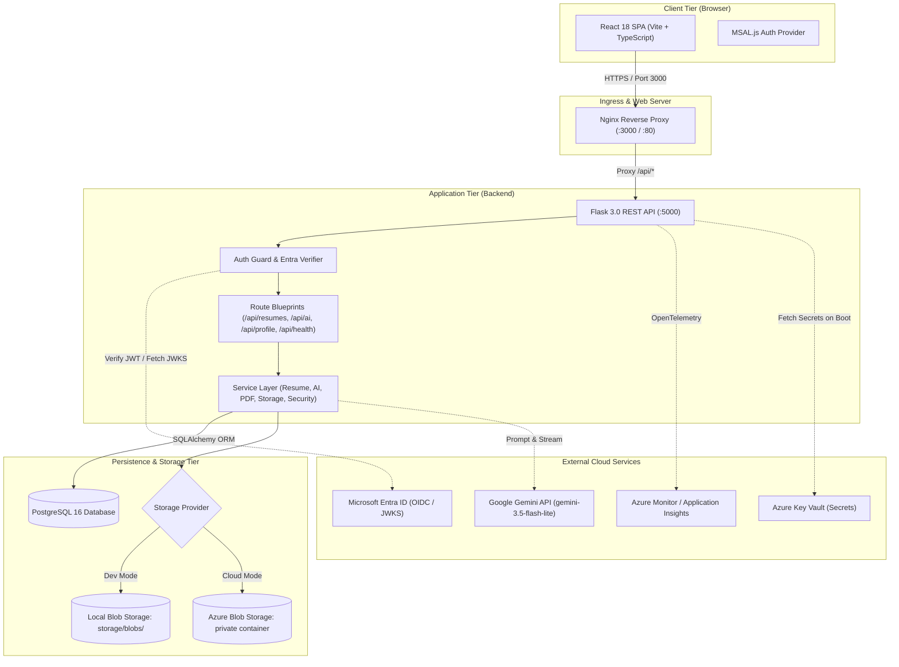
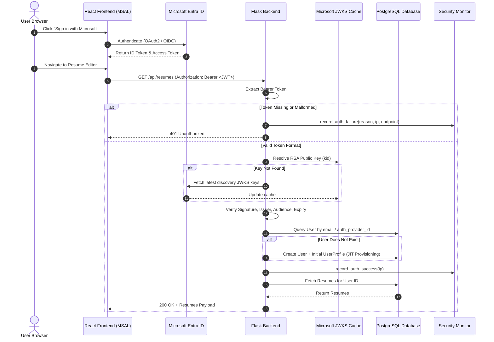
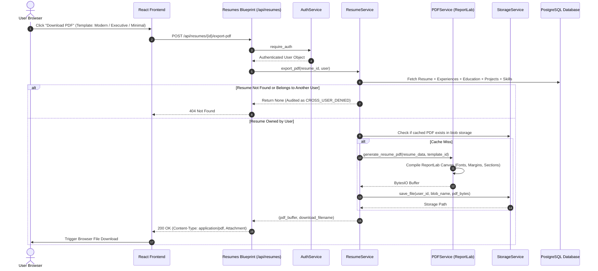
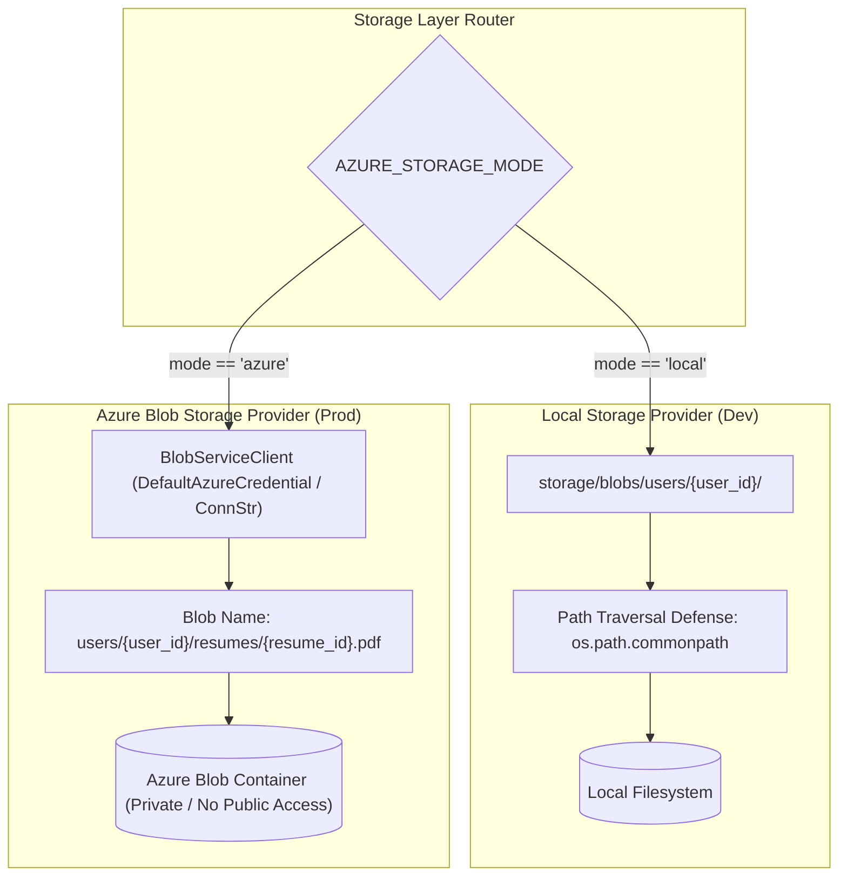
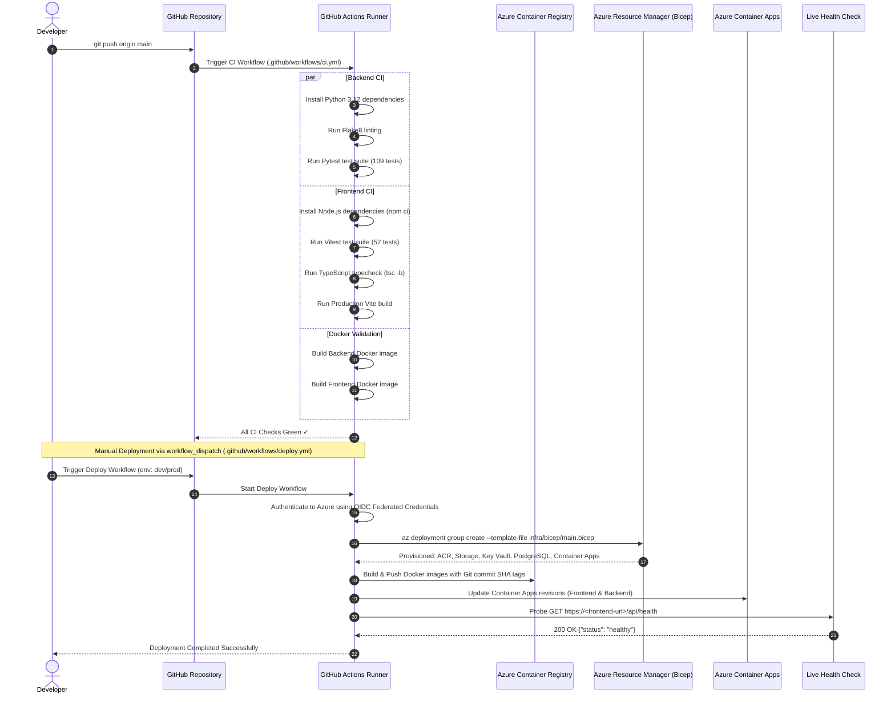

# System Architecture & Technical Design

## 1. System Architecture Overview

CloudResumeAI is an AI-powered resume engineering and cloud deployment platform architected specifically to demonstrate modern cloud-native principles: separation of concerns, containerization, least-privilege security, asynchronous AI orchestration, and cloud infrastructure as code.

The system is organized into a clean 5-tier architecture:

1. **Client / Presentation Layer**: Single Page Application (SPA) built with React 18, TypeScript, Tailwind CSS, and Vite. Implements Microsoft Entra authentication context, responsive resume editing interfaces, live ATS scoring, real-time AI assistant chat, and PDF preview/downloading.
2. **Application / REST API Layer**: Python 3.12 Flask service built with an Application Factory pattern. Features modular blueprints, Pydantic request/response validation, structured JSON logging, and correlation ID tracing.
3. **Domain & Business Logic Layer**: Isolated services handling authentication verification, AI prompt engineering, ReportLab PDF rendering, storage abstractions, and security event auditing.
4. **Data Persistence & Object Storage**:
   - Relational: PostgreSQL 16 (locally containerized; prepared for Azure Database for PostgreSQL Flexible Server).
   - Object/Blob Storage: Dual-mode storage engine supporting local filesystem storage with path traversal prevention and Azure Blob Storage private containers.
5. **External Cloud & AI Services**:
   - Google Gemini API (`gemini-3.5-flash-lite`) for conversational assistance and content optimization.
   - Microsoft Entra ID (Azure AD) for enterprise OAuth2/OIDC token verification.
   - Azure Key Vault for centralized cloud secret management.
   - Azure Monitor / Application Insights via OpenTelemetry for cloud observability.

---

## 2. High-Level Architecture Diagram



---

## 3. Subsystem Architectures & Workflows

### 3.1 User Authentication Flow

CloudResumeAI supports dual-mode authentication:
1. **Production Mode**: Microsoft Entra ID (Azure AD) OAuth2/OIDC JWT Bearer tokens verified against Microsoft's public JWKS endpoints with in-memory key caching.
2. **Development / Test Mode**: Controlled `X-Dev-User-Email` header, strictly rejected in production environments (`FLASK_ENV=production` or `ENV=production`).

Upon first login, the user is provisioned just-in-time (JIT) into the PostgreSQL database.



---

### 3.2 Resume Creation and PDF Export Flow

The PDF generation engine is powered by Python ReportLab, compiling resume JSON structures into high-resolution, vector-quality PDF documents. Documents are cached in the configured storage provider (Local or Azure Blob Storage) with private per-user partitioning.



---

### 3.3 Gemini AI Request Flow

The AI subsystem integrates Google Gemini (`gemini-3.5-flash-lite`) to provide instant resume summary rewriting, experience bullet bullet point optimization, job description alignment scoring, and conversational career guidance.

Features:
- Fixed SDK timeout using `types.HttpOptions(timeout=20000)`.
- Retry mechanism with exponential backoff on HTTP 429 rate limits or 503 transient overload.
- Prompt trimming to only 6 conversational messages to keep latency low.
- Request ID correlation propagated through `Server-Timing: gemini;dur=<ms>` response headers.

```mermaid
sequenceDiagram
    autonumber
    actor User as User Browser
    participant React as React Frontend
    participant Route as AI Blueprint (/api/ai/chat)
    participant AISvc as AIService
    participant GeminiSDK as Google GenAI Client
    participant GoogleAPI as Google Gemini API

    User->>React: Ask: "How can I improve my AWS project bullets?"
    React->>Route: POST /api/ai/chat (headers: X-Request-ID, Authorization)
    Route->>AISvc: chat(messages, resume_context, request_id)
    AISvc->>AISvc: Trim conversation history to last 6 messages
    AISvc->>AISvc: Assemble system prompt with resume context
    AISvc->>GeminiSDK: client.models.generate_content(model="gemini-3.5-flash-lite", config=...)
    GeminiSDK->>GoogleAPI: HTTPS POST /v1beta/models/gemini-3.5-flash-lite:generateContent
    alt Rate Limit (429) or Server Overload (503)
        GoogleAPI-->>GeminiSDK: 429 ResourceExhausted
        GeminiSDK->>AISvc: Catch Temporary Error
        AISvc->>AISvc: Backoff wait (1.5s)
        AISvc->>GeminiSDK: Retry call
        GeminiSDK->>GoogleAPI: HTTPS POST
    end
    alt Timeout (> 20s) or Deadline Exceeded
        GoogleAPI-->>GeminiSDK: DEADLINE_EXCEEDED / Socket Timeout
        GeminiSDK-->>AISvc: Timeout Exception
        AISvc-->>Route: Raise AIProcessingError(status_code=504)
        Route-->>React: 504 Gateway Timeout ("AI request timed out")
    else Success
        GoogleAPI-->>GeminiSDK: 200 OK + Candidates
        GeminiSDK-->>AISvc: Response Text
        AISvc->>AISvc: Calculate responseTimeMs
        AISvc-->>Route: {"reply": "...", "responseTimeMs": 1140}
        Route-->>React: 200 OK (Headers: Server-Timing: gemini;dur=1140, X-Request-ID)
        React->>User: Render formatted AI reply in chat bubble
    end
```

---

### 3.4 Azure Blob Storage Architecture & Workflow

Resume PDFs must remain strictly private to the user who created them. CloudResumeAI enforces zero public blob access through container configuration and strict user ID partition isolation.



---

### 3.5 CI/CD and Azure Deployment Architecture

Continuous integration and infrastructure deployment are managed entirely declaratively through GitHub Actions and Azure Bicep templates.



