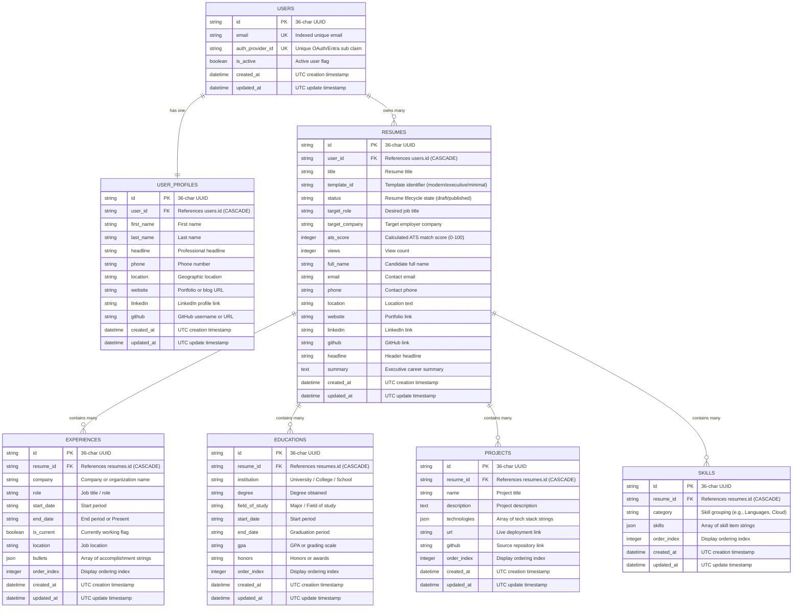

# Database Architecture & Entity-Relationship Documentation

## 1. Relational Database Overview

CloudResumeAI utilizes a relational schema built with PostgreSQL 16, orchestrated via SQLAlchemy ORM and managed through Alembic database migrations.

Key design highlights:
- **UUID Primary Keys**: Every table uses a standardized 36-character UUID string primary key generated via `uuid.uuid4().hex`.
- **Automatic Audit Timestamps**: Base `TimestampMixin` injects UTC `created_at` and `updated_at` datetime columns on every entity.
- **Cascading Deletions**: Deleting a `User` cascades to delete their `UserProfile` and all owned `Resume` documents. Deleting a `Resume` cascades to delete its associated `Experience`, `Education`, `Project`, and `Skill` child rows.
- **Tenant Isolation**: All operations are strictly bounded by `user_id`. Queries outside a user's tenancy are blocked at the repository layer and audited as security events.

---

## 2. Entity-Relationship (ER) Diagram



---

## 3. Entity Details & Schema Definitions

### 3.1 `User` (`users`)
Represents an authenticated principal within the CloudResumeAI platform.
- **Primary Key**: `id` (`VARCHAR(36)`), populated with a unique UUID string.
- **Indices & Constraints**:
  - `email`: `VARCHAR(255)`, indexed, unique, non-nullable.
  - `auth_provider_id`: `VARCHAR(255)`, indexed, unique, nullable. Holds the Microsoft Entra ID `sub` claim or custom identity provider subject.
- **Relationships**:
  - `profile`: One-to-one with `UserProfile` (`uselist=False`, `cascade="all, delete-orphan"`).
  - `resumes`: One-to-many with `Resume` (`cascade="all, delete-orphan"`, ordered by `updated_at DESC`).

### 3.2 `UserProfile` (`user_profiles`)
Stores contact information, URLs, and global candidate defaults across all resumes.
- **Primary Key**: `id` (`VARCHAR(36)`).
- **Foreign Key**: `user_id` (`VARCHAR(36)`), references `users.id` with `ondelete="CASCADE"`. Unique constraint guarantees a strict 1:1 relationship with `User`.
- **Fields**: First name, last name, phone, location, headline, personal website, LinkedIn URL, GitHub URL.

### 3.3 `Resume` (`resumes`)
Represents a resume document created and customized by an authenticated user.
- **Primary Key**: `id` (`VARCHAR(36)`).
- **Foreign Key**: `user_id` (`VARCHAR(36)`), references `users.id` with `ondelete="CASCADE"`.
- **Metadata**:
  - `template_id`: Theme identifier (`executive`, `modern`, `minimal`).
  - `status`: Lifecycle status (`draft`, `published`).
  - `target_role`, `target_company`: Target context used for Gemini ATS matching.
  - `ats_score`: Percentage score (0-100) assessing relevance against job requirements.
  - `views`: Counter recording document views.
- **Document Header Content**: `full_name`, `email`, `phone`, `location`, `website`, `linkedin`, `github`, `headline`, `summary`.
- **Child Collections**:
  - `experiences`: Collection of `Experience` models.
  - `educations`: Collection of `Education` models.
  - `projects`: Collection of `Project` models.
  - `skills`: Collection of `Skill` models.

### 3.4 `Experience` (`experiences`)
Captures professional work history, internships, and corporate experience.
- **Foreign Key**: `resume_id` (`VARCHAR(36)`), references `resumes.id` with `ondelete="CASCADE"`.
- **Key Columns**:
  - `company`, `role`: Required string titles.
  - `bullets`: `JSON` column storing an ordered array of accomplishment strings.
  - `order_index`: Integer for UI drag-and-drop sort order.

### 3.5 `Education` (`educations`)
Academic degrees, colleges, diplomas, and certifications.
- **Foreign Key**: `resume_id` (`VARCHAR(36)`), references `resumes.id` with `ondelete="CASCADE"`.
- **Key Columns**: `institution`, `degree`, `field_of_study`, `start_date`, `end_date`, `gpa`, `honors`, `order_index`.

### 3.6 `Project` (`projects`)
Academic, open-source, or client projects.
- **Foreign Key**: `resume_id` (`VARCHAR(36)`), references `resumes.id` with `ondelete="CASCADE"`.
- **Key Columns**:
  - `technologies`: `JSON` column storing tags (e.g., `["Flask", "React", "PostgreSQL", "Docker"]`).
  - `url`, `github`: Direct portfolio links.
  - `order_index`: Integer ordering.

### 3.7 `Skill` (`skills`)
Categorized technical and soft skills.
- **Foreign Key**: `resume_id` (`VARCHAR(36)`), references `resumes.id` with `ondelete="CASCADE"`.
- **Key Columns**:
  - `category`: Category header (e.g. `Languages`, `Cloud Technologies`, `Frameworks`).
  - `skills`: `JSON` column storing skill tags (e.g. `["Python", "TypeScript", "SQL"]`).
  - `order_index`: Integer ordering.

---

## 4. Ownership & Data Isolation Model

Tenant isolation is guaranteed by three layers of defense:

1. **Database Foreign Key Integrity**: Every resource references a `user_id` or a `resume_id` anchored to a `user_id`.
2. **Repository Layer Enforcement**:
   - `ResumeRepository.get_by_id(resume_id, user_id)` includes `WHERE resumes.id = :id AND resumes.user_id = :user_id`.
   - If a resume with the requested ID exists in the database but belongs to a different `user_id`, the repository returns `None` and invokes:
     ```python
     SecurityMonitor.record_cross_user_denial(
         user_id=user_id,
         target_resource=f"resume:{resume_id}",
         endpoint=request.path,
         client_ip=request.remote_addr,
     )
     ```
   - This ensures HTTP 404 is returned to the requester (preventing ID enumeration) while alerting administrators to potential lateral movement attempts.
3. **Storage Partitioning**: Stored PDF resumes are named according to `users/{user_id}/resumes/{resume_id}.pdf`. The storage service validates that the user accessing the blob matches the path prefix.

